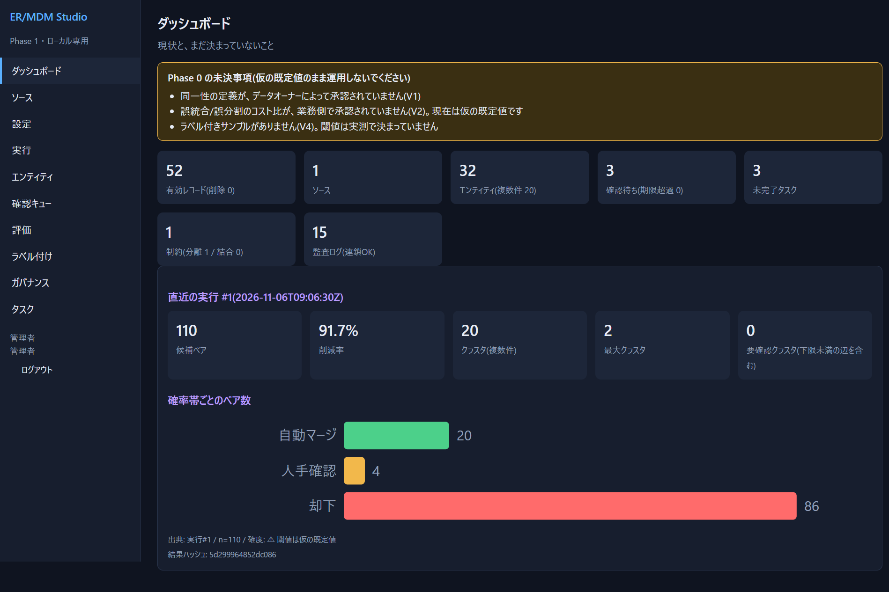

# ER/MDM Studio — 名寄せ(Entity Resolution)・マスターデータ管理

複数のシステムに散らばった「同じ顧客・同じ会社を指す記録」を見つけてまとめ、**共通のID(グローバルID)** を付けるためのローカル・アプリケーションです。判断の根拠を見せ、人が確認して直せ、結果を再現できることを重視しています。



| こんな人向け | 内容 |
|---|---|
| 名寄せが初めてのエンジニア | 手順どおりに進めれば、**誰にも聞かずに**自分のCSVで名寄せまで到達できます([ユーザーズガイド](users-guide/README.md)) |
| データ連携の担当者 | ファイル連携・DB同期で「同じデータの同定」が難しい問題を、確率モデルと確認作業で扱います |

> **状態(必ず読んでください)** これは **Phase 1(ローカルで動く最初の版)** です。閾値などの既定値は仮のもので、検証はすべて**合成データ**で行いました。実データでの精度は未測定です。本番投入の前に、[限界](users-guide/09-limitations.md)を確認してください。

## 5分で動かす

必要なもの: **Python 3.12**(開発・検証した版。3.10 以上なら動く想定ですが未検証)と Web ブラウザ。外部パッケージのインストールは**不要**です。

```powershell
git clone https://github.com/dahatake/Entity-Resolution-and-Master-Data-Management-Studio.git
cd Entity-Resolution-and-Master-Data-Management-Studio\app
python -m ermdm serve --data .\data --port 8800 --admin-password "好きなパスワード(8文字以上)"
```

ブラウザで <http://127.0.0.1:8800/> を開き、ユーザー名 `admin`、上のパスワードでログインします。
ダッシュボードの **「人物デモ(1,000件)」** を押すと、合成データが読み込まれ、名寄せまで自動で実行されます。そのあとの見方は [クイックスタート](users-guide/03-quickstart-demo.md) を読んでください。

自分のデータで試す手順は [自分のデータで名寄せする](users-guide/04-your-own-data.md) にあります(サンプルのCSVと設定ファイル付き)。

## ドキュメント

[`users-guide/`](users-guide/README.md) にまとめています。迷ったら先頭から順に読んでください。

| 読むもの | 内容 |
|---|---|
| [01 名寄せの基礎と用語](users-guide/01-concepts.md) | 何を解く道具か。用語集 |
| [02 インストールと起動](users-guide/02-install-and-start.md) | 起動オプション、ユーザー作成、データの置き場所 |
| [03 クイックスタート(デモ)](users-guide/03-quickstart-demo.md) | 合成データで一通り体験(約15分) |
| [04 自分のデータで名寄せする](users-guide/04-your-own-data.md) | CSV → 設定 → 実行 → 確認(約45分) |
| [05 画面リファレンス](users-guide/05-screen-reference.md) | 10画面の全項目 |
| [06 設定リファレンス](users-guide/06-config-reference.md) | 標準化・ブロッキング・モデル・閾値のJSON |
| [07 運用・ガバナンス](users-guide/07-operations.md) | 役割、利用目的、監査、再現性、バックアップ、出力 |
| [08 困ったとき(FAQ)](users-guide/08-troubleshooting.md) | エラーと対処 |
| [09 限界と注意](users-guide/09-limitations.md) | できないこと、既知の不具合 |

## リポジトリの構成

| パス | 内容 |
|---|---|
| [`app/`](app/README.md) | アプリ本体(Python標準ライブラリのみ、SQLite、d3.js)。テストは `app/tests/` |
| [`users-guide/`](users-guide/README.md) | 利用者向けドキュメントとスクリーンショット、サンプルデータ |
| [`work/`](work/) | 調査レポート(`IssueAnalyticsReport.md`)、PoC検証レポート(`PoC-ResultAnalyticsReport.md`)、要求定義(`prd.md`) |
| [`PoC/`](PoC/README.md) | 調査項目ごとの小さな実験コードと結果 |

## 開発者向け

```powershell
cd app
python -W ignore -m unittest discover -s tests   # 自動テスト(61件、約8秒)
python -m ermdm coverage                         # 要求(PRD)とテストの対応表を生成
```

要求と設計の根拠は [`work/prd.md`](work/prd.md)、調査は [`work/IssueAnalyticsReport.md`](work/IssueAnalyticsReport.md) を参照してください。

## ライセンス

[LICENSE](LICENSE) を参照してください。同梱の d3.js は ISC ライセンスです(`app/web/vendor/d3-LICENSE.txt`)。
