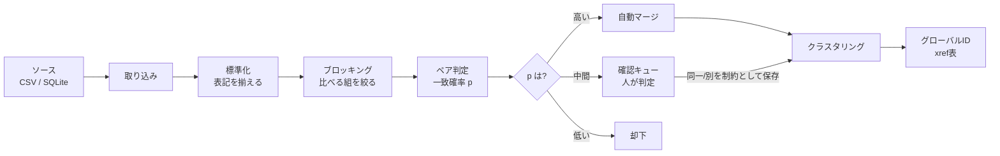

# 01 名寄せの基礎と用語

## 何を解く問題か

大企業のシステムでは、業務の連携をファイルの受け渡しやDBの同期で行います。そのとき、次のことが起きます。

- 営業システムでは「株式会社北斗運輸」、経理システムでは「北斗運輸(株)」、物流システムでは「㈱北斗運輸」。**同じ会社なのに、IDも表記もばらばら**。
- 逆に、同じ名前でも別の会社(本店所在地が違う)がある。

**名寄せ(Entity Resolution)** は、「どの記録が同じ実体(人・会社)を指すか」を判定して、同じ実体に**共通のID**を付ける作業です。

名寄せが難しい理由は、「**同じ**とは何か」が業務で決まることと、**間違いのコストが非対称**なことです。

| 間違い | 何が起きるか | 呼び方 |
|---|---|---|
| 別人を同じにしてしまう | 請求や個人情報が混ざる。取り返しが付きにくい | 誤統合(false merge) |
| 同じ人を別にしてしまう | 重複が残る。二重に営業する | 見逃し(false split) |

このアプリは、**どちらの間違いが重いか(コスト比)を人が決め**、**確率で判定し**、迷うものを**人が確認する**ことで、この問題を扱います。

## このアプリの処理の流れ

1. **取り込み**: CSV や SQLite から記録を読む。個人番号(マイナンバー)らしい列は保存せず隔離する。
2. **標準化**: 「(株)」→ 除去、全角→半角、「6丁目28番15号」→「6-28-15」のように**表記を揃える**。
3. **ブロッキング**: 全部の組み合わせ(n×n)は多すぎるので、「電話が同じ」「町字が同じ」など**似ていそうな組だけ**を候補にする。
4. **ペア判定**: 候補の各組について、項目ごとの一致・不一致の証拠を足し合わせ、**同一である確率 p** を出す(Fellegi–Sunter モデル)。
5. **3つの帯域**: p が高ければ自動で統合、中間なら人が確認、低ければ却下。
6. **クラスタリング**: 統合された組をつないで、同じ実体のグループ(クラスタ)にする。
7. **グローバルID**: クラスタごとに安定したIDを付け、「ソースのID ↔ グローバルID」の対応表(xref)に保存する。元のデータは変更しない。

## 用語集

| 用語 | 意味 |
|---|---|
| **ソース** | データの出どころ(1つのCSVや1つのDBテーブル)。例: `customers` |
| **レコード(記録)** | ソース内の1行。アプリ内では `rid` という通し番号が付く |
| **キー列** | ソース内で1行を一意に決める列(例: `id`)。重複や空は取り込めない |
| **エンティティ / グローバルID** | 同じ実体と判定された記録のグループと、その共通ID |
| **xref表** | ソースID ↔ グローバルID の対応表。下流システムが使う成果物 |
| **標準化** | 比較の前に表記を揃える処理(NFKC正規化、法人格の除去、住所の正規化など) |
| **ブロッキング** | 比較する組を絞る処理。絞りすぎると本当の一致を取りこぼす |
| **候補ペア** | ブロッキングで残った、比較する2件の組 |
| **確率 p** | その組が同一である確率。**候補ペアの中での確率**で、全ペアに対する確率ではない |
| **λ(ラムダ)** | 候補ペアのうち、本当に同一な組の割合(モデルが推定)。画面では「事前 λ」 |
| **ビット(bit)** | 項目ごとの「同一である証拠の強さ」。正なら一致の証拠(緑)、負なら不一致の証拠(赤) |
| **自動マージ閾値 / 確認下限** | p がこの値以上なら自動統合 / この値以上なら人が確認。下回れば却下 |
| **確認キュー** | 人が「同一/別」を判定する待ち行列 |
| **制約(must / cannot)** | 人の判定を固定したもの。「同一」→結合を固定、「別」→分離を固定。再実行しても覆らない |
| **連結成分と推移閉包** | A=B、B=C なら A=C とする規則。**鎖でつながる別人を1つにしてしまう**危険がある |
| **不純クラスタ** | 中に「別人」と判定された組を含むクラスタ(要確認) |
| **アンマージ(分割)** | 誤って統合されたクラスタを分け、新しいIDを付ける。理由が必須で、制約として残る |
| **PC(Pairs Completeness)** | 本当の一致ペアのうち、候補ペアに**入った**割合。**再現率の上限**(ブロッキングで落ちたものは取り戻せない) |
| **適合率 / 再現率 / F1** | 適合率=統合した組のうち正しい割合、再現率=本当の一致のうち見つけた割合、F1=その調和平均 |
| **コスト比** | 誤統合1件を、見逃し何件分の重さと見るか。最適な閾値はこれで決まる |
| **結果ハッシュ** | 実行結果の指紋。同じ入力・設定なら同じ値になる(再現性の確認) |
| **監査ログ** | 誰がいつ何をしたかの記録。ハッシュで連鎖しており、改ざんを検知できる |
| **Phase 0** | 本番の前に決めるべきこと(同一性の定義、コスト比、実測など)。アプリのダッシュボードに未決事項として出る |

## 先に知っておくと迷わない3つのこと

1. **Accuracy(正解率)は見ません。** ペアのほとんどは「別」なので、全部「別」と答えても高く見えます。適合率・再現率・PC を見ます。
2. **確率 p は「候補の中での確率」で、データから自動推定されます。** 候補に「別」の組がほとんど含まれないと、推定が偏ります(→ 04 の「ブロッキングを絞りすぎない」)。
3. **閾値の既定値(自動0.9 / 下限0.5 など)は仮の値です。** 業務が決めたコスト比と、ラベルを付けた実測で決め直してください。
