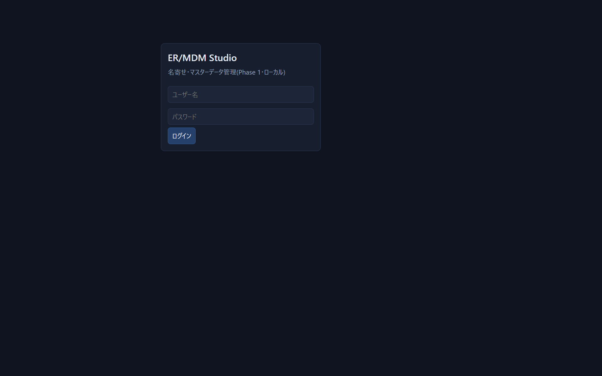
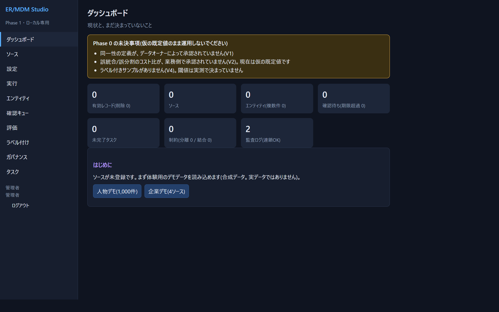

# 02 インストールと起動

## 必要なもの

| 必要なもの | 備考 |
|---|---|
| Python 3.12 | ✅ この版で開発・検証。3.10 以上なら動く想定(⚠ 未検証)。`python --version` で確認 |
| Web ブラウザ | Chromium 系ブラウザ(自動操作用のChromium)で確認 ✅。Chrome / Edge も同系統のため動く想定(⚠ 実機では未確認)。JavaScript が使えること |
| ディスク | データは SQLite 1ファイル。デモなら数MB |
| インターネット | **不要**。d3.js も同梱。アプリは外部へ通信しません(テストで確認 ✅) |

**pip install は不要**です(Python標準ライブラリだけで動きます)。

## 手順1 取得

```powershell
git clone https://github.com/dahatake/Entity-Resolution-and-Master-Data-Management-Studio.git
cd Entity-Resolution-and-Master-Data-Management-Studio\app
```

## 手順2 起動

```powershell
python -m ermdm serve --data .\data --port 8800 --admin-password "ここに8文字以上のパスワード"
```

出力例:

```
データディレクトリ: C:\...\app\data
http://127.0.0.1:8800/ で待ち受け中(127.0.0.1 限定)。Ctrl+C で終了。
```

ブラウザで <http://127.0.0.1:8800/> を開きます。ログイン画面が出ます。



- ユーザー名は **`admin`**、パスワードは上で指定したものです。
- `--admin-password` を省くと、**初回だけ**乱数のパスワードが表示されます(その場で控えてください。再表示はできません)。
- `Ctrl+C` で止めます。データは `--data` のフォルダに残り、次回同じ `--data` で起動すれば続きから使えます。

## 起動オプション

| コマンド | 意味 |
|---|---|
| `python -m ermdm serve` | サーバーを起動(初回はデータフォルダと管理者を自動作成) |
| `python -m ermdm init` | 起動せずに、データフォルダと管理者だけ作る |
| `python -m ermdm demo persons` / `companies` | デモデータを読み込んで1回実行する(画面のデモボタンと同じ) |
| `python -m ermdm useradd 名前 役割1,役割2` | ユーザーを追加(→ [07](07-operations.md)) |
| `python -m ermdm verify` | 監査ログのハッシュ連鎖を検証 |
| `python -m ermdm coverage` | 要求とテストの対応表を生成(開発者向け) |

| オプション | 既定 | 意味 |
|---|---|---|
| `--data フォルダ` | `./data` | SQLite(`ermdm.db`)と取り込み用フォルダ(`import/`)の場所。**コマンドを実行したフォルダからの相対**なので、毎回同じ場所で実行するか、絶対パスを指定する |
| `--port 番号` | `8800` | 待ち受けポート |
| `--admin-password` | 乱数 | 管理者(`admin`)の初期パスワード。**初回作成時のみ**有効 |
| `--demo-users` | なし | 役割ごとのデモユーザーを作る(`steward` / `demo-steward-pass` など)。**ローカル検証専用**。本番では使わない |

## 手順3 動作確認

ログインすると、ダッシュボードが出ます。**この画面が出れば起動成功**です。



見方:

- 黄色い枠は「**Phase 0 の未決事項**」です。同一性の定義・コスト比・ラベル付きサンプルが未決のままだと警告します。警告が出るのは正常です(→ [04](04-your-own-data.md))。
- 数字のカードがすべて 0 なのは、まだデータが無いからです。
- 「はじめに」のボタンで、体験用のデモデータを読み込めます(→ [03](03-quickstart-demo.md))。

## セキュリティ上の約束

- サーバーは **`127.0.0.1`(自分のPC)からしか接続できません**。他のPCやネットワークには公開されません。`Host` ヘッダが `127.0.0.1:ポート` か `localhost:ポート` でない要求は拒否します。
- 認証は1台のPCで使うための簡易なものです(PBKDF2ハッシュのパスワード、HttpOnly の Cookie、12時間で期限切れ)。**インターネットに公開しないでください。**
- 個人データは外部へ送られません。

## 初めてつまずきやすい点

| 症状 | 原因と対処 |
|---|---|
| `python` が見つからない | Python をインストールし、PATH に追加する。Windows なら `py -3.12 -m ermdm serve ...` でも可 |
| ページが開かない | 起動したウィンドウが閉じていないか。`http://127.0.0.1:8800/`(`https` ではない)か。ポートが他で使われていれば `--port 8810` など別の番号にする |
| ログインできない | `--admin-password` は**初回作成時のみ**有効。変えたい場合は `--data` を別フォルダにする(→ [08](08-troubleshooting.md)) |
| 別のポートで2つ起動したらログインが外れる | Cookie はポートで分かれず、ホスト名(`127.0.0.1`)で共有されるため(⚠ 観察)。一方を `localhost` で開くと分けられる |
