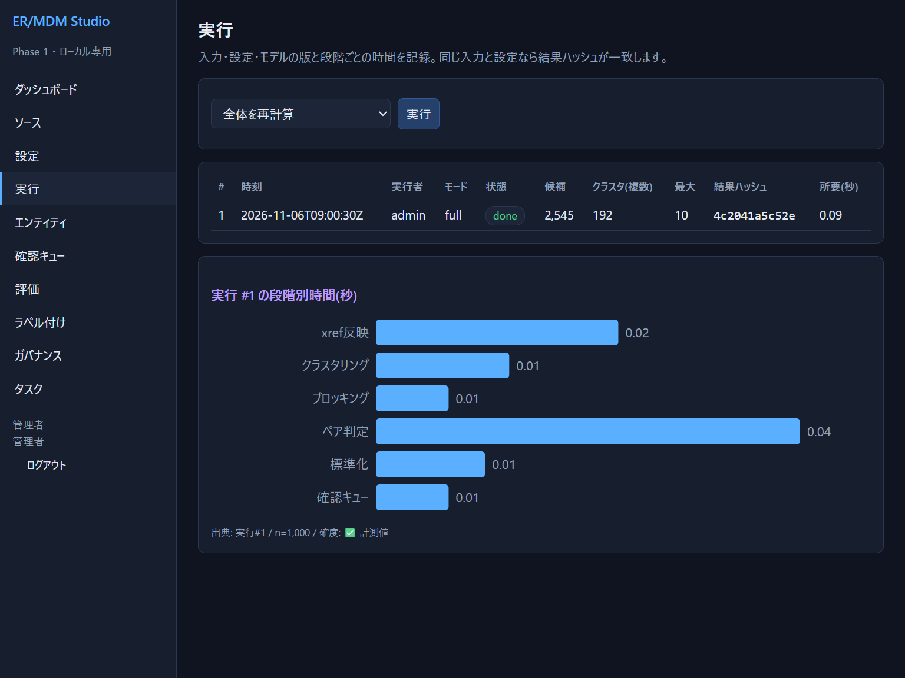
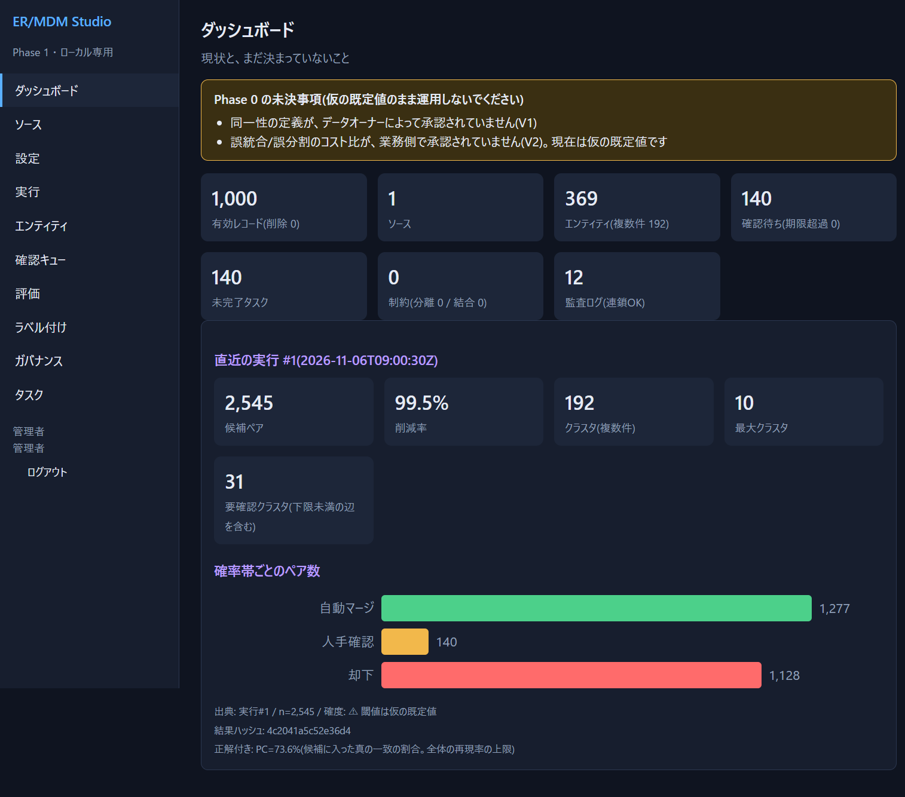
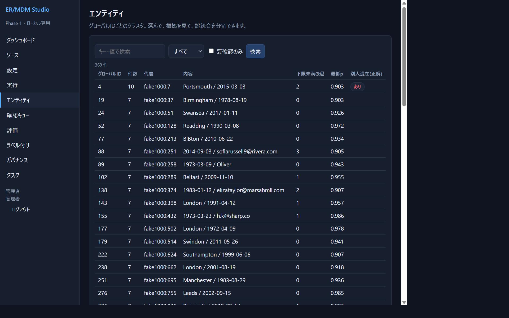
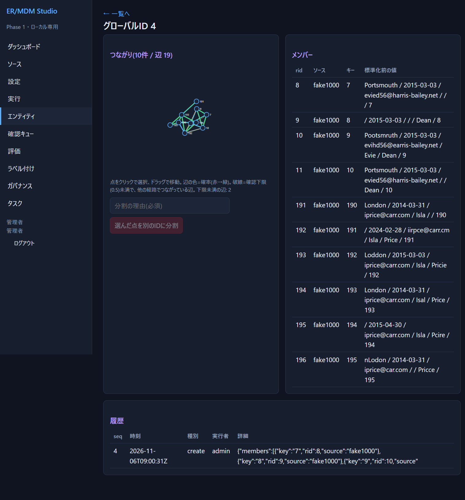
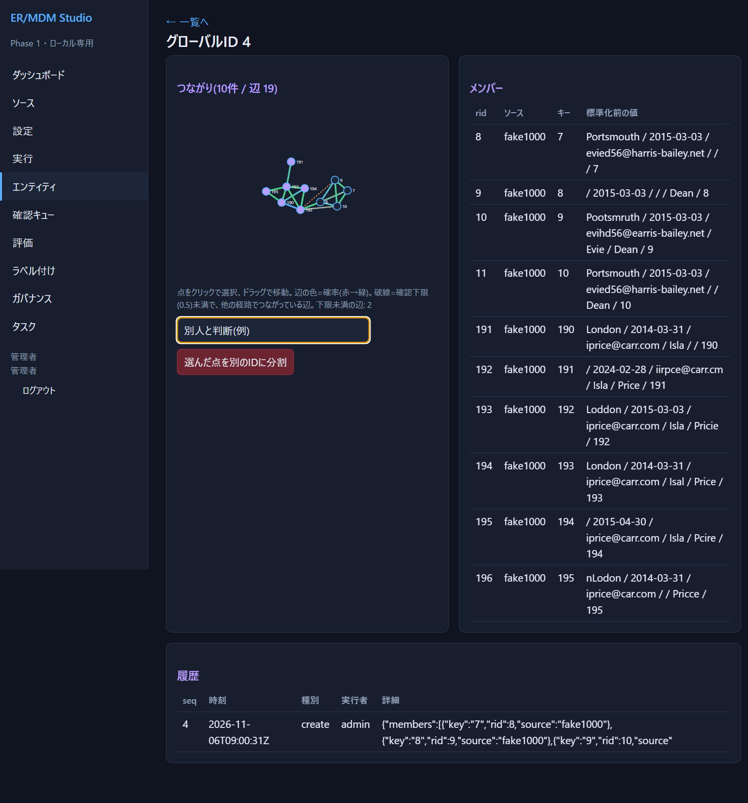
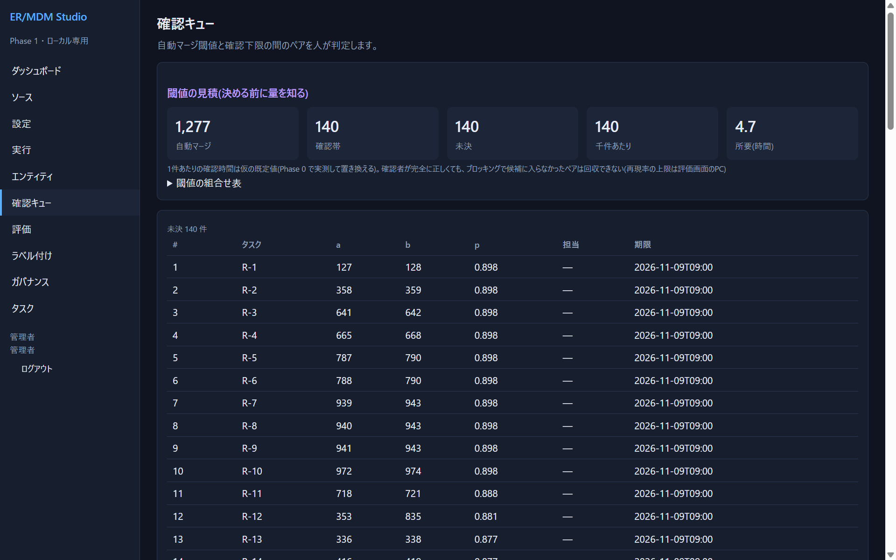
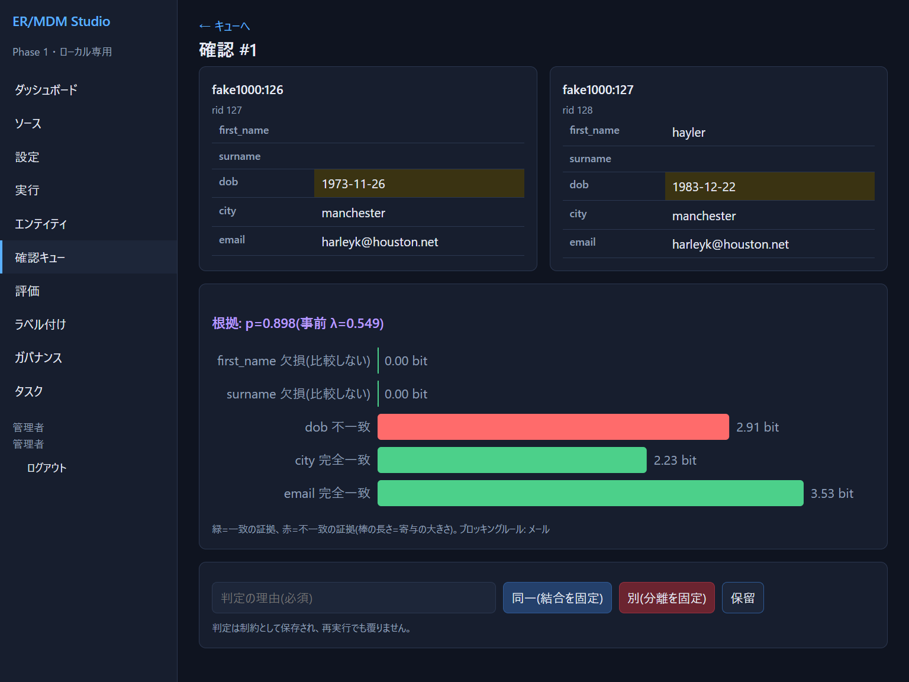
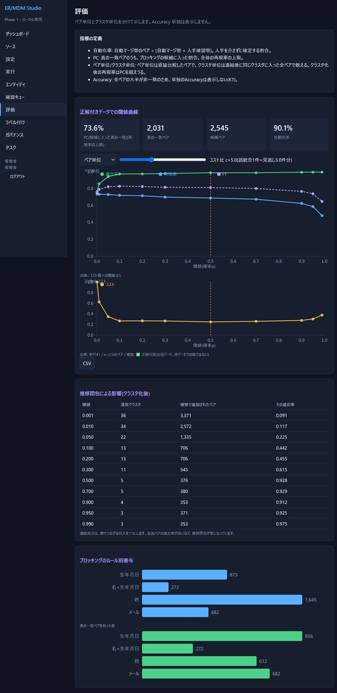
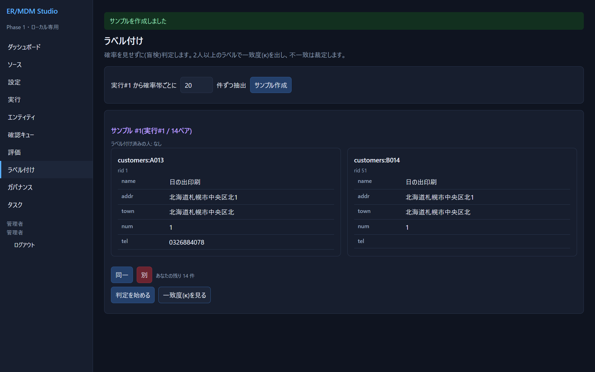
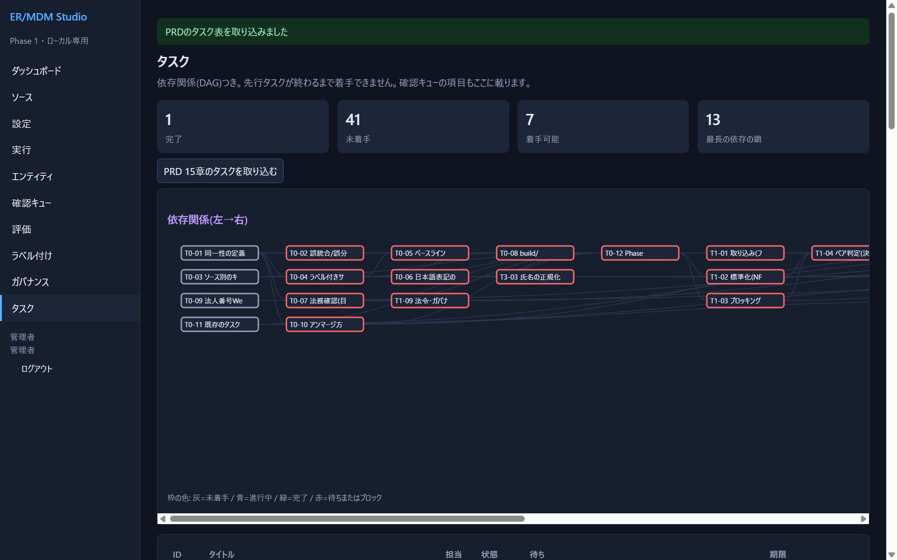

# 03 クイックスタート(デモで体験する)

所要 約15分。合成データ(実在の人物ではない)で、**取り込み → 名寄せ → 確認 → 分割 → 評価**を一通り見ます。自分のデータで進めたい人は、先に [04](04-your-own-data.md) へ進んでも構いません。

> 前提: [02](02-install-and-start.md) で起動し、`admin` でログインしていること。デモは**空のワークスペースにだけ**読み込めます。

## 1. デモを読み込む

ダッシュボードの「はじめに」で **「人物デモ(1,000件)」** を押します。1,000件の人物データ(同じ人が表記ゆれ・誤字で複数入っている)が取り込まれ、設定とモデルの学習を済ませ、名寄せまで実行されます。数秒で「実行」画面に移ります。

- 実行 #1 の状態が `done` になっていれば成功です。
- 「結果ハッシュ」は結果の指紋です。**同じデータ・同じ設定で再実行すると同じ値**になります(再現性の証拠)。
- 下のグラフは、段階ごとの所要時間(秒)です。

## 2. ダッシュボードを読む

左のメニューから「ダッシュボード」を開きます。

| 表示 | 読み方(この例) |
|---|---|
| 有効レコード 1,000 / エンティティ 369(複数件 192) | 1,000件が369個のグローバルIDにまとまった。うち192個は2件以上を含む |
| 候補ペア 2,545 / 削減率 99.5% | 全ペア約50万組のうち、2,545組だけを比べた(ブロッキングの効果) |
| 最大クラスタ 10 | 最も大きいグループは10件 |
| 要確認クラスタ 31 | 中に「確率が確認下限を下回る組」を含むクラスタ(つなぎ方が怪しい) |
| 確率帯ごとのペア数 | 自動マージ 1,277 / 人手確認 140 / 却下 1,128 |
| 「PC=73.6%」 | 本当の一致ペアのうち候補に入った割合。**どんなに判定が良くても、再現率はこれを超えられない** |
| 黄色い枠(Phase 0 の未決事項) | 同一性の定義とコスト比が未承認、という警告。デモでは仮の値で動いています |

## 3. エンティティを見る

メニュー「エンティティ」を開きます。グローバルIDごとのクラスタの一覧です。

- 「件数」の多い順です。「要確認のみ」で、下限未満の辺を含むクラスタに絞れます。
- 「別人混在(正解)」は、デモデータに**正解が入っている**ので出る列です。実データでは出ません。
- 行をクリックすると詳細が開きます。件数10の `4` を開いてください。

- 左: **つながりの図**。丸=レコード、線=比較した組(緑ほど確率が高い)。点線は、確認下限(0.5)未満なのに**他の経路でつながって同じクラスタに入っている**組です。ドラッグで動かせます。
- 右: メンバーの表(標準化前の元の値)。
- 下: このIDの履歴(いつ・誰が作った/分割したか)。

この `4` は、実は **2人(Evie Dean と Isla Price)が1つにされている**例です。連結成分は「A=B、B=C ならA=C」とするので、鎖でつながって別人が混ざることがあります。

## 4. 誤統合を分割する

図の `190`〜`195`(Isla Price 側の6点)をクリックして選びます(選ぶと紫になります)。「分割の理由(必須)」を入力し、赤いボタンを押します。

- **理由は必須**です。監査ログに残ります。
- 分割すると、**大きい方のグループが元のIDを引き継ぎ**、小さい方に新しいIDが付きます(「選んだ点」が新しいIDになるとは限りません)。新しいIDの画面に移ります。
- 分割は**否定制約**として保存されます。以後に再実行しても、この2グループは再統合されません。
- 新しいIDには「前身ID: 4」と記録され、旧IDからも追跡できます。

## 5. 確認キューで判定する

メニュー「確認キュー」を開きます。自動で決められない中間の組(0.5 ≤ p < 0.9)が並びます。

- 上の枠は「**閾値を決める前に量を知る**」ための見積です。自動マージ閾値と確認下限を動かすと、人が見る件数・所要時間がどう変わるかを表にしてあります(1件2分は**仮の前提**)。
- 行をクリックして、1組を開きます。

- 上: 2件の標準化後の値。違っていた項目は黄色で強調されます。
- 中: **判定の根拠**。項目ごとの証拠の強さ(ビット)。**緑は「同一」の証拠、赤は「別」の証拠**で、棒が長いほど強い。この例では、`email`・`city`が一致(緑)、`dob`が不一致(赤)です。
- 下: 理由を書いて、**「同一(結合を固定)」/「別(分離を固定)」/「保留」**のどれかを押します。理由は必須です。判定は制約として保存され、**再実行しても覆りません**。

## 6. 評価を見る

メニュー「評価」を開きます。

- デモには正解があるので、**閾値ごとの適合率・再現率・F1** が出ます(ペア単位/クラスタ単位は上のプルダウンで切替)。
- スライダーは**コスト比**です。「誤統合1件は見逃し何件分の重さか」。右に動かすと誤統合を嫌う設定になり、**点線(コスト最小の閾値)が右へ動きます**。
- 「推移閉包による影響」の表は、クラスタ化で**追加された組の適合率**を示します。低い行ほど、連鎖で別人が混ざっています。
- 「CSV」ボタンで曲線の数値を取り出せます。
- Accuracy(正解率)は出しません(理由は [01](01-concepts.md))。

デモの値(例): 閾値0.9で、ペアの適合率 約99.5%、再現率 約62.6%。再現率が低いのは、PC(73.6%)という上限があるためです。

> これは**合成データでの値**で、実データの精度ではありません。

## 7. ラベル付け(正解を作る)

実データには正解がありません。**人が判定した正解(ラベル)を一部に付けて**、精度を推定します。

1. 「サンプル作成」: 確率の帯ごとに同じ数ずつ抽出します(**層化抽出**)。確率の高い組ばかり見ると偏るためです。
2. 「判定を始める」→ 2件を見て **「同一」/「別」**。**確率は見せません**(判定が引きずられるため。盲検)。
3. 2人以上が付けると、「一致度(κ)を見る」で判定者間の一致度が分かります。食い違った組は、裁定が必要です。

ここまでが一巡です。次は [04](04-your-own-data.md) で自分のデータを使います。

## 8. 利用目的とタスク(参考)

- 「ガバナンス」: 個人データを扱うソースには**利用目的の登録**が必要です(デモでは登録済み)。
- 「タスク」: PRD(要求定義書)のタスク表を取り込んで、**依存関係つき**で進捗を管理できます。

枠が赤いタスクは、先行タスクが終わっていないため着手できません。確認キューの項目(`R-1` など)もタスクとして並びます。

詳細は [05 画面リファレンス](05-screen-reference.md) を参照してください。
