# 04 自分のデータで名寄せする

所要 約45分。サンプルの取引先CSV(`sample/customers.csv`)で、**空の状態から、取り込み → 設定 → 実行 → 確認 → 結果の取り出し**まで進めます。自分のCSVでも同じ手順です(違う点は各所に書きました)。

> **検証済み**: この手順は、空のデータフォルダから実際に操作し、本文の数値と一致することを確認しました(✅)。

## 0. 準備

新しいデータフォルダで起動します(デモのデータと混ざらないようにするため)。

```powershell
cd Entity-Resolution-and-Master-Data-Management-Studio\app
python -m ermdm serve --data .\data-tutorial --port 8800 --admin-password "8文字以上のパスワード"
```

<http://127.0.0.1:8800/> を `admin` でログインします。

## 1. データを知る

[`sample/customers.csv`](sample/customers.csv) は、52行・4列(`id,name,addr,tel`)です。**同じ会社が、書き方を変えて複数入っています。**

| id | name | addr | tel | 備考 |
|---|---|---|---|---|
| A006 | 株式会社東海精工 | 東京都渋谷区神南2丁目8番3号 | 03-7955-1968 | 元の表記 |
| B007 | 東海精工 株式会社 | 東京都渋谷区神南2丁目8番3号 | (空) | 同じ会社(後株)。電話が欠けている |
| A031 | 株式会社旭ソフト | 神奈川県横浜市西区みなとみらい5丁目21番19号 | 03-8301-5662 | 元の表記 |
| B032 | ㈱旭ソフト | 神奈川県横浜市西区みなとみらい５ー２１ー１９ ○○ビル3F | 0383015662 | 同じ会社(㈱、全角、建物名つき、電話のハイフンなし) |
| A005 | 株式会社大和商事 | 東京都新宿区西新宿4丁目2番3号 | 03-8104-7851 | |
| C001 | 株式会社大和商事 | 大阪府大阪市北区梅田2丁目5番8号 | 06-6123-4567 | A005 と**同名で別の会社**(別の場所) |

- キー列は `id`(一意で、空でない)。名寄せでは「重複を探したい**同じ種類のデータ**」を1つのソースにしても、複数ソースに分けても構いません。
- 自分のデータでは、**まず先頭の数十行を目で見て**、どんな表記ゆれがあるかを確認してください。標準化の設計に直結します。
- **個人番号(マイナンバー)の列は入れないでください。** 入っていると取り込み時に隔離されます(→ [07](07-operations.md))。

## 2. ソースを追加して、データを取り込む

メニュー「ソース」を開きます(空の状態)。

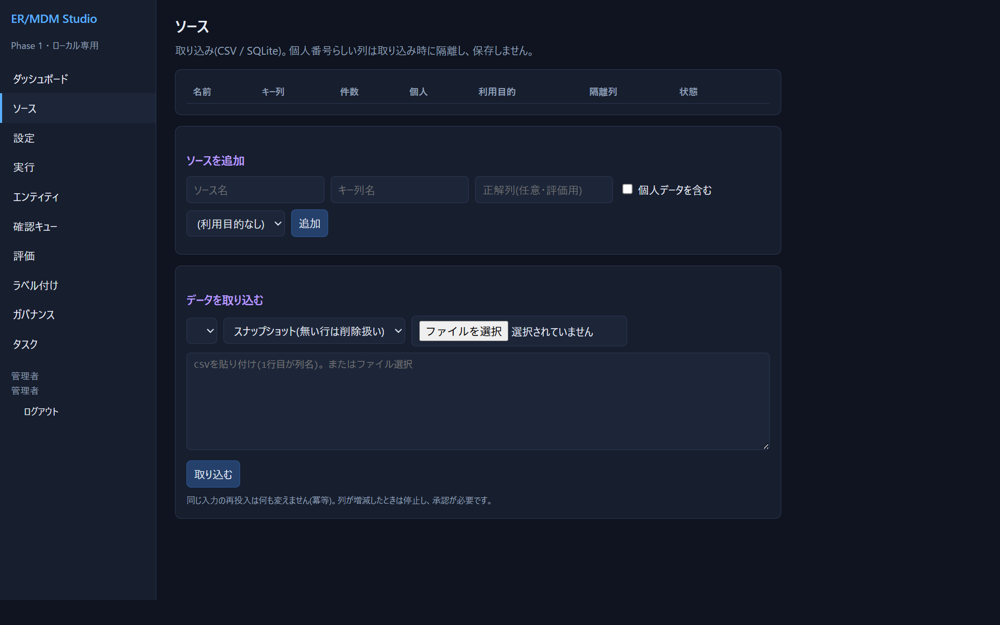

「ソースを追加」に次を入力して **「追加」** を押します。

| 項目 | 入力 |
|---|---|
| ソース名 | `customers` |
| キー列名 | `id` |
| 正解列 | (空のまま。正解があるデータなら、その列名を入れると評価画面に正解付きの曲線が出ます) |
| 個人データを含む | 今回はオフ(**人の氏名・住所などを扱うならオン**にして、利用目的も選ぶ。→ [07](07-operations.md)) |

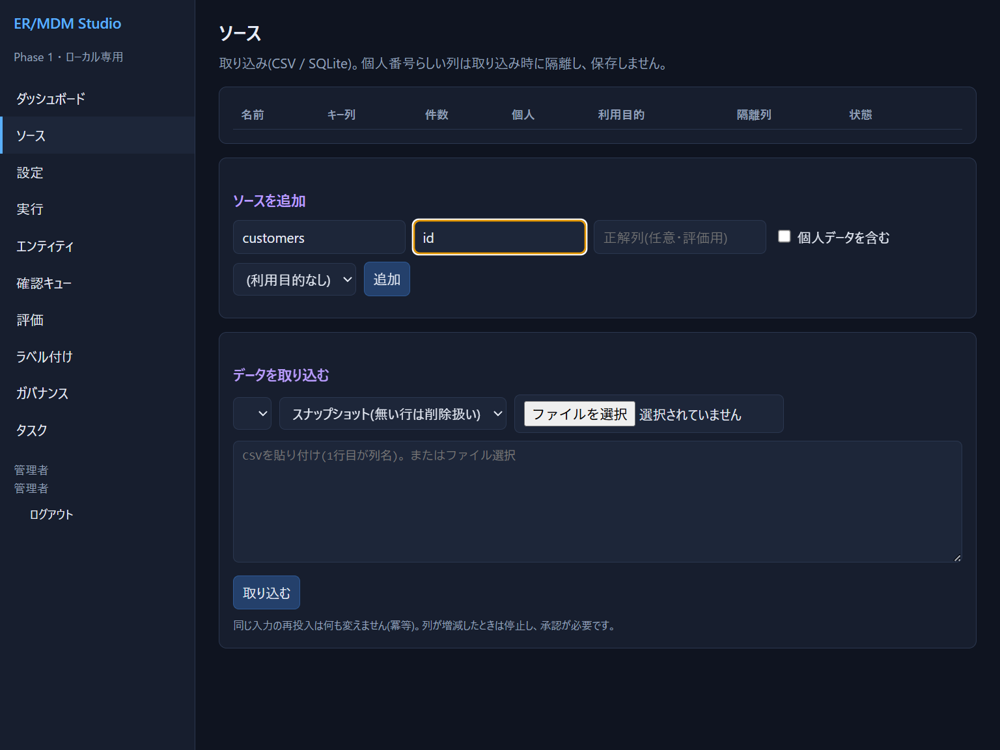

次に「データを取り込む」で、ソース `customers`・「スナップショット」を選び、**ファイルを選択**で `sample/customers.csv` を選んで「取り込む」を押します(CSVを貼り付けてもOK。文字コードは UTF-8 と Shift_JIS(CP932)を自動判別します)。

取り込みが終わると、画面上部に結果が出て、一覧の件数が **52** になります。

> 同じファイルをもう一度取り込むと「追加0 / 更新0 / 削除0 / **変更なし52**」になります。**同じ入力を何度入れても結果は変わりません**(冪等)。下はそのときの画面です。

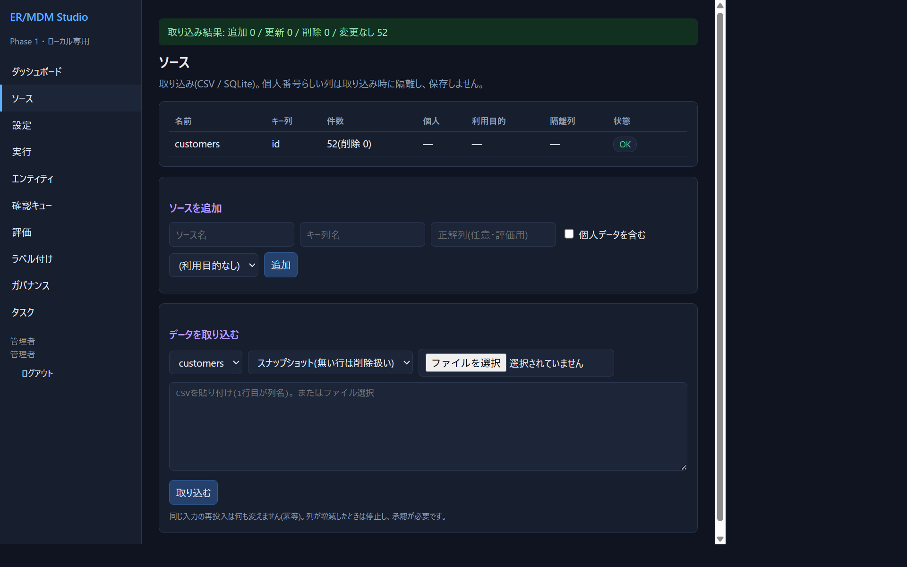

取り込みの種類:

| 種類 | 意味 |
|---|---|
| スナップショット | ファイルが「その時点の全件」。**ファイルに無い既存の行は削除扱い**になる(削除は xref・クラスタにも伝わる) |
| 差分 | 追加・更新・削除だけ。`__op` という列に `I` / `U` / `D` を書く |

列が増減したファイルを取り込もうとすると、**止まります**。ソース一覧に「スキーマ変更の承認待ち」が出るので、内容を確認して「承認」を押してください。

## 3. 設定する

メニュー「設定」を開きます。上から順に設定します。ここで JSON を書く部分は、サンプルが `sample/` にあるので**コピーして貼り付け**てください([書き方の詳細は 06](06-config-reference.md))。

### 3-1. 同一性の定義とコスト比

「同一性の定義」の欄に、**何を「同じ」とみなすか**を文章で書きます。例:

> 取引先(法人)について、同じ法人(本店所在地が同じ)を指す記録を同一とする。支店・事業所は別とする。

「保存」を押します。これは**業務側が決めて承認すべきこと**です。承認は「承認として保存」で記録され、承認者名が残ります(今回は練習なので、未承認のまま進めて構いません。ダッシュボードの黄色い警告は残ります)。

「誤統合1件のコスト ÷ 見逃し1件のコスト」は、既定 5(仮の値)のままで構いません。

### 3-2. 標準化

「標準化」の欄に、[`sample/customers-std.json`](sample/customers-std.json) の中身を貼り付けます。

```json
{
 "label": "customers-v1",
 "fields": [
  {"name": "name", "ops": ["nfkc", "lower", "corp", "variant", "punct", "nospace"], "sources": {"*": ["name"]}},
  {"name": "addr", "ops": ["addr"], "sources": {"*": ["addr"]}},
  {"name": "town", "ops": ["addr", "addr_town"], "sources": {"*": ["addr"]}},
  {"name": "num", "ops": ["addr", "addr_num"], "sources": {"*": ["addr"]}},
  {"name": "tel", "ops": ["phone"], "sources": {"*": ["tel"]}}
 ]
}
```

読み方: 比較に使う項目(`name`, `addr`, `town`, `num`, `tel`)を、元の列(`sources`)から、**`ops` を上から順に適用して**作ります。`"*"` は「すべてのソース」の意味です。

- `name`: 全角→半角(`nfkc`)→小文字→法人格(株式会社・(株)・㈱ など)を除去(`corp`)→異体字→記号除去→空白除去
- `addr`: 丁目・番地・号・ハイフンを数字とハイフンに揃え、建物名を落とす
- `town`・`num`: 正規化した住所を「町字まで」「番地の数字部分」に分ける(あとで別々に比較する)
- `tel`: 数字だけにする

まず **「プレビュー」** を押して、結果を確認します(保存はまだされません)。

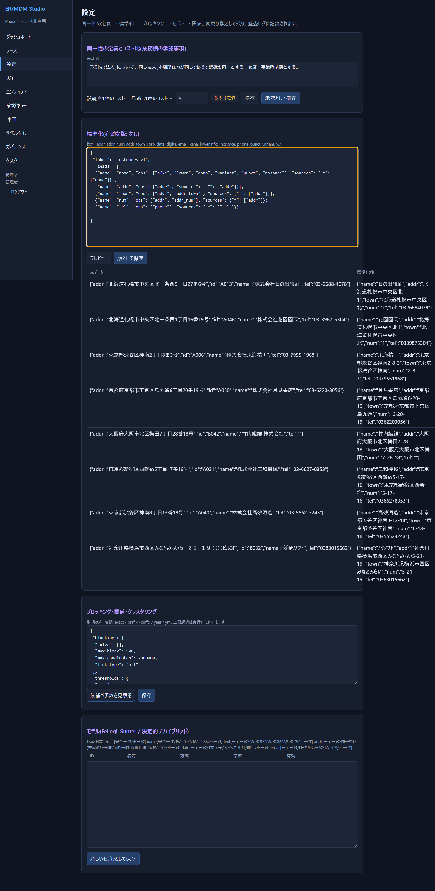

右の「標準化後」を見て、`株式会社日の出印刷` のような法人格つきの名前が `日の出印刷` に、住所が `東京都渋谷区神南2-8-3` のような形に揃うことを確認します。**ここで揃っていないものは、後で一致と判定できません。** 納得したら **「版として保存」** を押します(同じ内容なら同じ版、変えると新しい版になり、有効な版が切り替わります)。

> ⚠ **既知の制限**: プレビューで札幌の住所が `北海道札幌市中央区北1` のように**途中で切れて**見えます。「北一条西9丁目…」の「条」を、番地の数字の一部と読んでしまうためです(✅ 確認済み。→ [09](09-limitations.md))。この練習では、電話と町字で別の経路から一致するので結果に影響しませんが、**札幌など「条・丁目」の住所が多いデータでは、住所を決め手にしないでください**。

### 3-3. ブロッキング・閾値

「ブロッキング・閾値・クラスタリング」の欄に、[`sample/customers-pipeline.json`](sample/customers-pipeline.json) を貼り付けます。

```json
{
 "blocking": {
  "rules": [
   {"name": "電話", "keys": [{"field": "tel"}]},
   {"name": "町字", "keys": [{"field": "town"}]}
  ],
  "max_block": 500,
  "max_candidates": 2000000,
  "link_type": "all"
 },
 "thresholds": {"auto": 0.9, "review_low": 0.02},
 "clusterer": "components",
 "seed": 1
}
```

- ルールは「**このキーが同じ組を比べる**」という意味です。2つのルールの**和集合**が候補ペアになります。ここでは「電話が同じ」または「町字が同じ」。
- `thresholds`: `auto` 以上は自動マージ、`review_low` 以上 `auto` 未満は確認、未満は却下。**今回は `review_low` を 0.02 と低めにして**、確認キューに「怪しい組」が出るようにしてあります。

**「候補ペア数を見積る」** を押します。

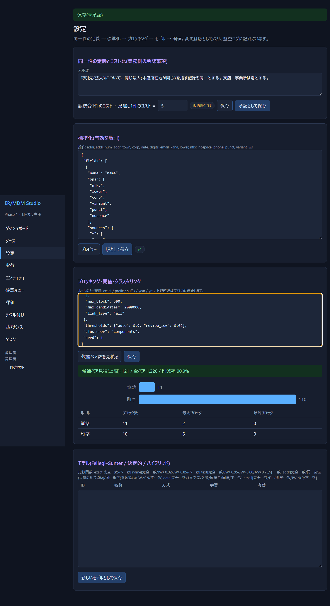

「候補ペア見積(上限): 121 / 全ペア 1,326 / 削減率 90.9%」と、ルールごとの内訳(電話 11、町字 110)が出ます。**上限**なのは、2つのルールで重なった組を二重に数えているためです(実際の候補は110組になります)。見積が上限(`max_candidates`)を超えると、**ペアを作る前に実行が止まり**、状態が `failed` になります(組み合わせの爆発を防ぐため)。問題なければ **「保存」** を押します。

> **ブロッキングは絞りすぎないでください。** 試しに「電話が同じ」と「名称の先頭2文字+町字の先頭4文字が同じ」だけにすると、候補20組がすべて「同じ会社」になり、モデルが「別」の見本を見られず、**λが 1.000 に張り付いて**判定が壊れます(私たちの検証 ✅)。モデル表の「学習済(λ=…)」が 1.000 に近い、確認キューが0件、という症状が出たら、ブロッキングを緩めてください。本当の一致を落とさず、かつ「別」の組も混ざる、くらいが目安です。

### 3-4. モデル

「モデル」の欄に、[`sample/customers-model.json`](sample/customers-model.json) を貼り付けて、**「新しいモデルとして保存」** を押します。

```json
{
 "matcher": "fs",
 "fields": [
  {"name": "name", "cmp": "text"},
  {"name": "town", "cmp": "text"},
  {"name": "num", "cmp": "exact"},
  {"name": "tel", "cmp": "exact"}
 ]
}
```

- `matcher: fs` は Fellegi–Sunter(確率モデル)。`fields` で、標準化で作った項目のどれを、どの**比較関数**で比べるか決めます(`text`=文字列の似かた5段階、`exact`=一致/不一致)。
- モデル表に新しい行ができます。行の **「学習」** を押すと、候補ペアから、各項目の一致の強さが**自動推定**されます。表示が「済(λ=0.183)」になります。
- 続けて **「有効化」** を押します(**未学習のモデルは有効化できません**)。行の「有効」欄に ● が付けば完了です。

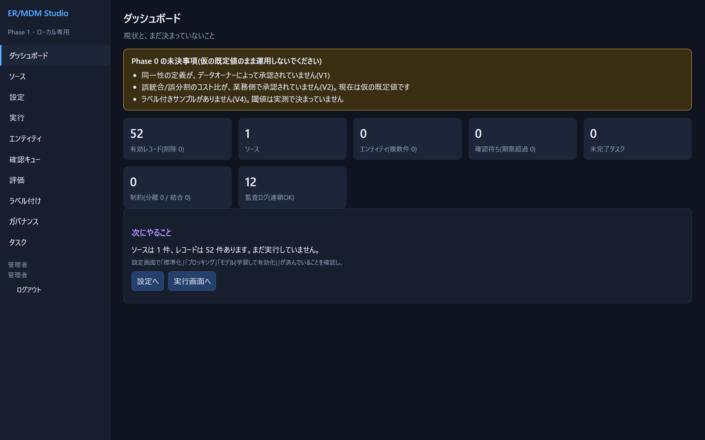

λ=0.183 は「候補ペアの約18%が本当に同じ会社」という推定です。これは学習のたびに**候補ペアから自動で推定**されます(正解は使っていません)。

## 4. 実行する

メニュー「実行」を開き、**「実行」** を押します(全体を再計算)。ダッシュボードには、実行前は「ソースは1件、レコードは52件あります。まだ実行していません」と出ます。


数秒で、実行 #1 が `done` になります。候補 110、クラスタ(複数)20、最大 2 です。

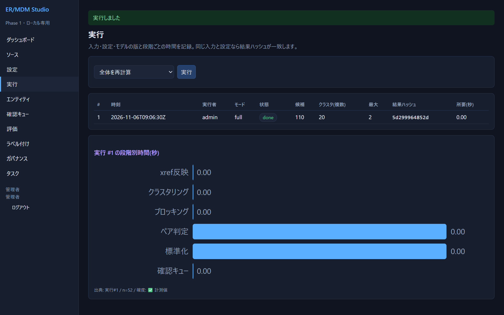

> 失敗した場合は、状態が `failed` になり、理由が出ます(例: 標準化の設定がない、モデルが有効でない、候補ペア数が上限超過)。→ [08](08-troubleshooting.md)

## 5. 結果を見る

### ダッシュボード

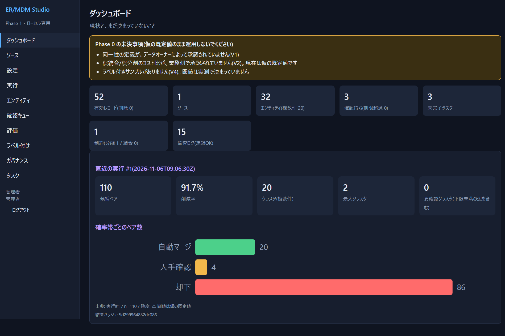

| 表示 | この例 | 読み方 |
|---|---|---|
| エンティティ | 32(複数件 20) | 52件が32個のIDにまとまった。20個は2件のペア(同じ会社が2回入っていた) |
| 確率帯ごと | 自動マージ 20 / 人手確認 4 / 却下 86 | 20組は自動で統合、4組は人が確認、86組は別と判断 |
| 要確認クラスタ | 0 | 不整合なクラスタはない |

### エンティティ

メニュー「エンティティ」で一覧を見ます。

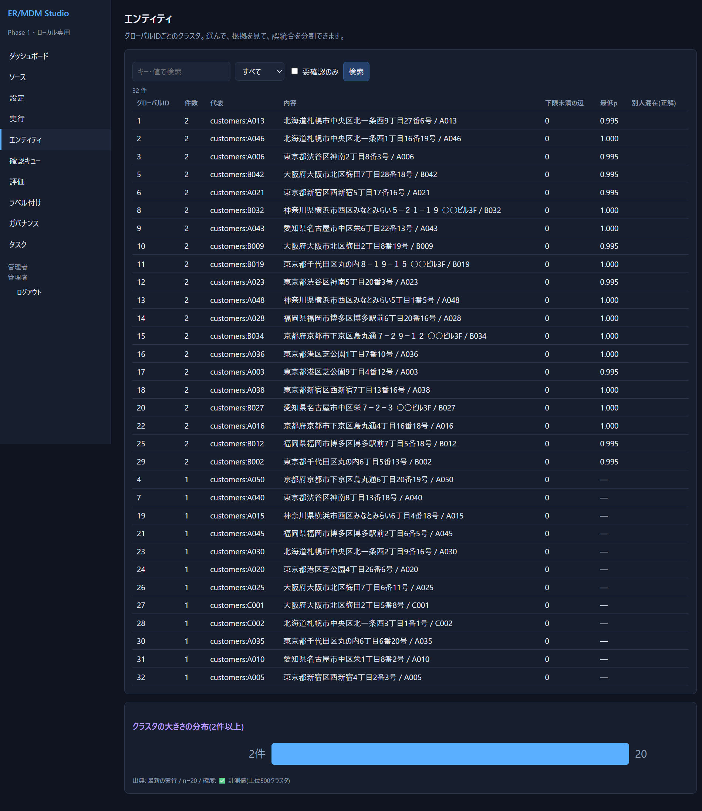

- 2件のIDには、`A013` と `B014` のように「元のID」と「別表記のID」がまとまっています。
- 「最低p」はクラスタ内で最も弱いつながりの確率です。**低いものから見る**と、怪しいクラスタを早く見つけられます。
- 1件のまま残った行(`C001` 大和商事 など)は、**同名でも別の会社(所在地が違う)と判定**され、統合されていません。

### 確認キュー

メニュー「確認キュー」を開きます。人が見るべき4組が出ます。

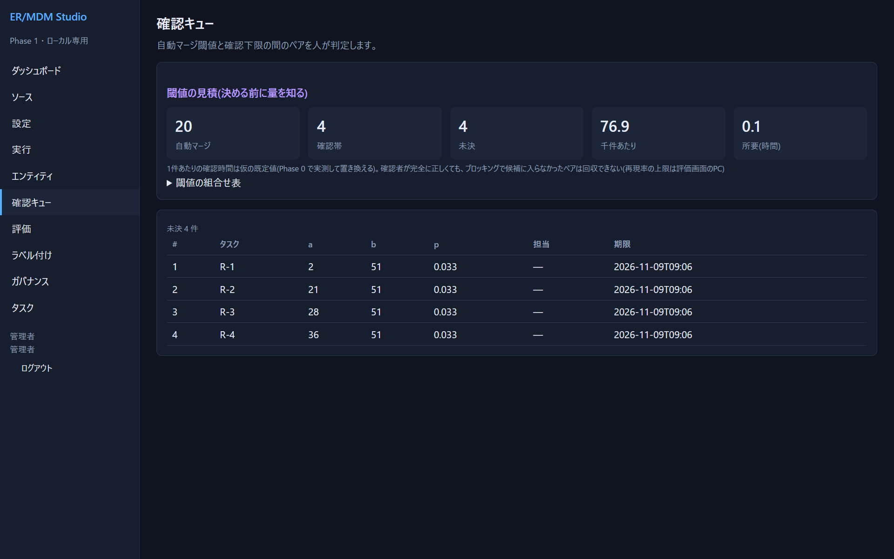

1行目を開きます。

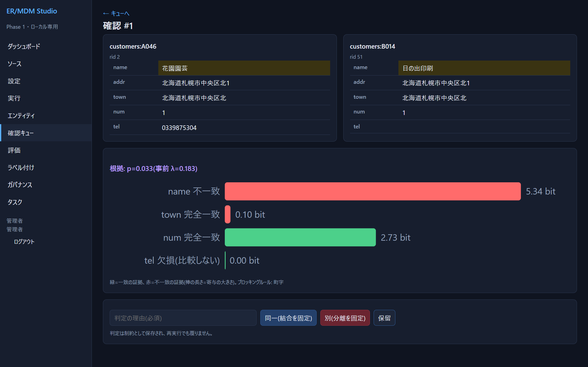

- **根拠**: `name` が不一致(赤・5.34ビット)で、`town` と `num` は一致しています。**名前が全く違う**ので、p は 0.033 と低く、2社は別です(住所が同じ町字・番地というだけ)。
- 判定: 理由に「名前が異なる別法人」などを入れ、**「別(分離を固定)」** を押します。

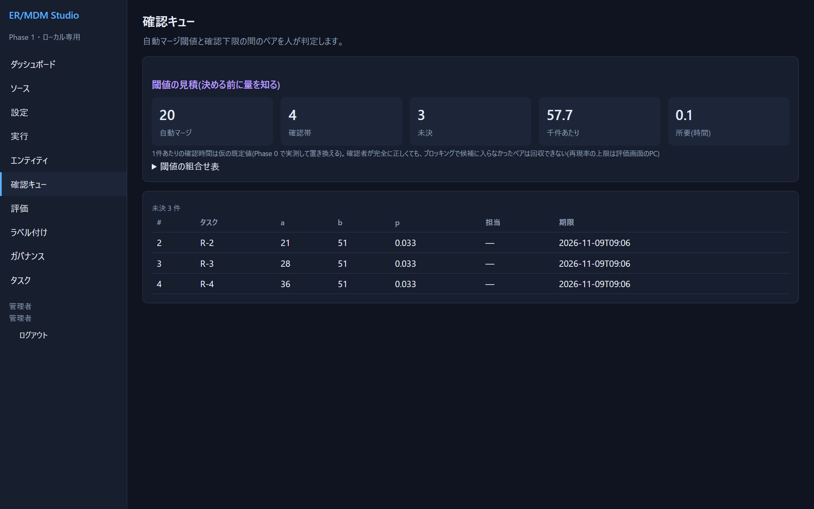

- 判定すると、確認キューから消え、ダッシュボードの「制約」に「分離 1」と出ます。**この判定は、再実行しても覆りません**。
- 確認待ちが4→3になり、確認項目はタスク(`R-1` など)としても管理されます。

### 判定の根拠が納得できないとき

- 同じ会社なのに p が低い → 標準化が足りない(表記が揃っていない)か、`name` の比較が厳しすぎる。「設定 → プレビュー」で、その2件の標準化後の値を確認します。
- 別の会社なのに p が高い → 比較項目が少ない/弱い。電話・番地など、**決め手になる項目**をモデルに足します。

## 6. 結果を取り出す

名寄せの成果物は、**ソースID ↔ グローバルID の対応表(xref)** です。ブラウザでログインしたまま、次のURLを開くとダウンロードできます(`export` 権限が必要。`admin`・データオーナー・データエンジニア・評価担当・下流システム管理者)。

| 取り出すもの | URL |
|---|---|
| xref(CSV: `source,key,global_id`) | <http://127.0.0.1:8800/api/export/xref.csv> |
| 変更イベント(JSON Lines。統合・分割・廃止の履歴) | <http://127.0.0.1:8800/api/export/events.jsonl> |
| ソースIDから引く | <http://127.0.0.1:8800/api/xref?source=customers&key=B014> |
| IDの現在の状態(統合で廃止されたIDの後継) | <http://127.0.0.1:8800/api/gid/5/resolve> |

xref.csv の例(✅):

```
source,key,global_id
"customers","A013","1"
"customers","B014","1"
"customers","A046","2"
```

`A013` と `B014` が同じ会社として、グローバルID `1` を共有しています。**元のデータは変更されません。** 下流システムは、この対応表(と、変更イベント)を取り込みます。

## 7. 精度を測る(実データのとき)

デモと違い、実データには正解がありません。**閾値を決める前に、必ず一部にラベルを付けてください。**

1. 「ラベル付け」でサンプルを作る。確率の帯ごとに同数を抽出します。
2. 2人以上で判定する(盲検)。κで一致度を確認し、食い違いは**裁定**する(裁定の操作は API のみ → [05](05-screen-reference.md))。
3. 「評価」に、**サンプルからの推定値(信頼区間つき)** が出ます。区間が広いなら、ラベルが足りません。

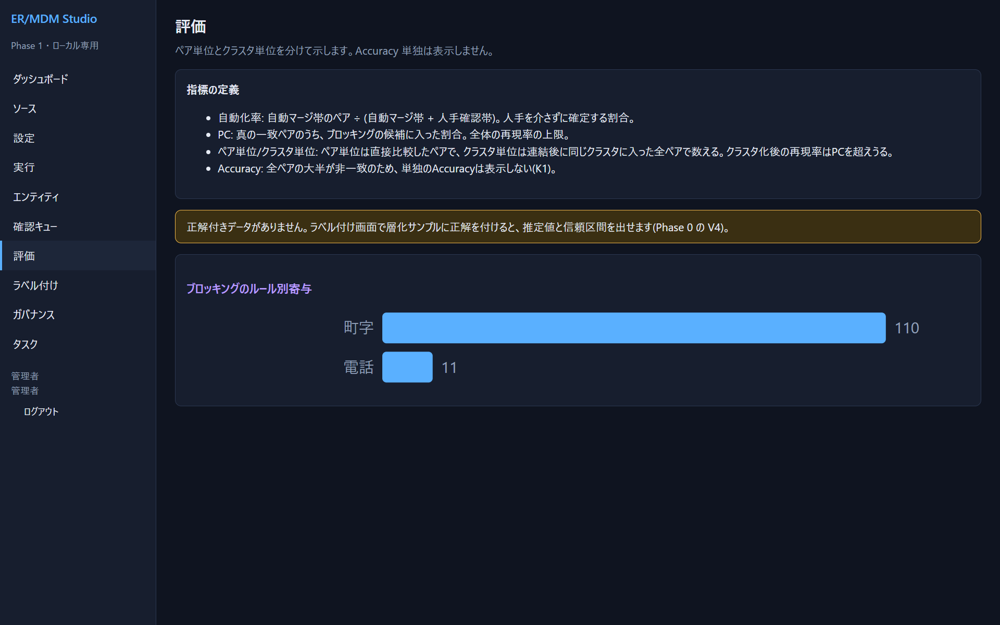

正解列つきのデータなら、取り込み時の「正解列」に列名を入れると、デモのように閾値曲線が出ます(**評価専用で、判定には使われません**)。

## 8. 再実行と更新

- データが増えたら、「ソース」で**同じソースにもう一度取り込み**、「実行」で再計算します。
- 既存のレコードのグローバルIDは**変わりません**(統合されたIDは若い番号に寄せ、廃止IDには後継IDを記録)。
- 設定を変えたら、「実行」の「全体を再計算」。閾値だけ変えたときは「再クラスタのみ」で速く再計算できます。
- 結果ハッシュが前回と同じなら、**入力・設定が同じで結果も同じ**です。

次に読むもの: [05 画面リファレンス](05-screen-reference.md) / [06 設定リファレンス](06-config-reference.md) / [07 運用・ガバナンス](07-operations.md)
