# 05 画面リファレンス

メニューは左側に並びます。**役割によって、見える画面と押せるボタンが変わります**(→ [07](07-operations.md))。権限が無い操作のボタンは表示されないか、実行すると「権限がありません」と出ます。

| 画面 | できること | 必要な権限(役割) |
|---|---|---|
| [ダッシュボード](#ダッシュボード) | 現状、未決事項、直近の実行 | 全員 |
| [ソース](#ソース) | データの登録・取り込み | 見る: 全員 / 取り込み: `ingest`(データエンジニア、管理者) |
| [設定](#設定) | 同一性の定義、標準化、ブロッキング、モデル | 見る: 全員 / 定義・コスト比: `settings`(データオーナー、管理者) / 標準化・ブロッキング・モデル: `config`(データエンジニア、評価担当、管理者) |
| [実行](#実行) | 名寄せの実行と履歴 | 見る: 全員 / 実行: `run`(データエンジニア、評価担当、管理者) |
| [エンティティ](#エンティティ) | グローバルIDの一覧、つながりの図、分割 | 見る: 全員 / 分割: `unmerge`(データオーナー、データスチュワード、管理者) |
| [確認キュー](#確認キュー) | 中間の組の判定 | 見る: 全員 / 判定: `review`(データオーナー、データスチュワード、管理者) |
| [評価](#評価) | 精度の指標と閾値の最適化 | 全員 |
| [ラベル付け](#ラベル付け) | 正解づくり(盲検) | `label`(データスチュワード、評価担当、管理者) |
| [ガバナンス](#ガバナンス) | 利用目的、ユーザー、監査ログ | 利用目的の登録: `purpose`(法務、管理者)/ ユーザー一覧: 管理者 / 監査ログ: `audit`(法務、監査担当、管理者) |
| [タスク](#タスク) | 作業と依存関係の管理 | 見る: 全員 / 着手・完了・PRD取り込み: `task` |

画面の端の「ログアウト」で終了します。ログインは12時間で切れます。

## ログイン

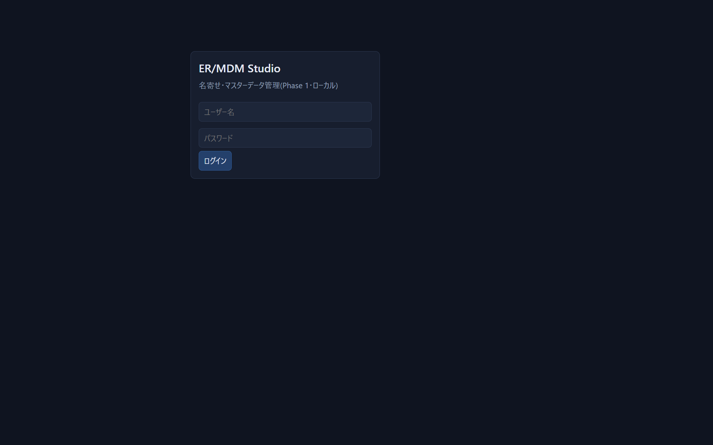

ユーザー名とパスワードを入れて、Enter か「ログイン」。誤りは「ユーザー名またはパスワードが違う」旨が出ます。

## ダッシュボード

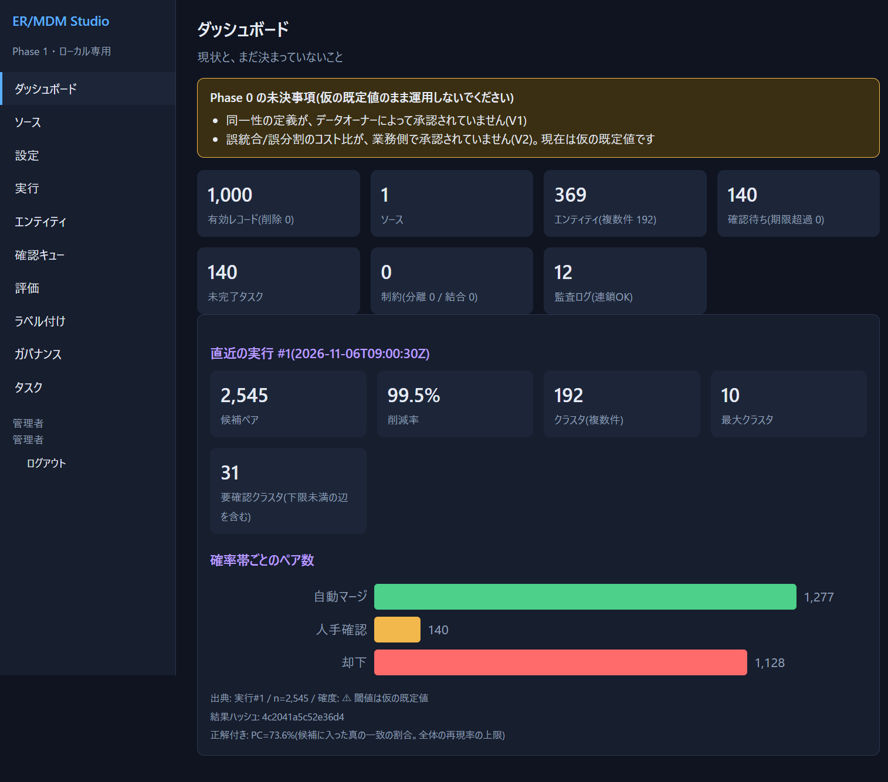

| 部品 | 意味 |
|---|---|
| **黄色い枠** | Phase 0 の未決事項。同一性の定義・コスト比が承認されていない、ラベル付きサンプルがない、個人データの利用目的がない、など。**解消するまで「仮の値で動いている」状態** |
| **赤い枠** | 監査ログの連鎖が壊れている(改ざんの疑い)/ ガバナンス違反(例: 個人データのソースに利用目的がなく、**実行できない**) |
| カード | 有効レコード、ソース数、エンティティ数(複数件を含む数)、確認待ち(期限超過)、未完了タスク、制約の数、監査ログの件数 |
| 直近の実行 | 候補ペア、削減率、クラスタ数、最大クラスタ、要確認クラスタ、確率帯ごとのペア数、結果ハッシュ。正解がある場合は PC も |
| はじめに | ソースがまだ無いとき、デモの読み込みボタン(管理者)。ソースがあって未実行のときは、「設定へ」「実行画面へ」 |

## ソース

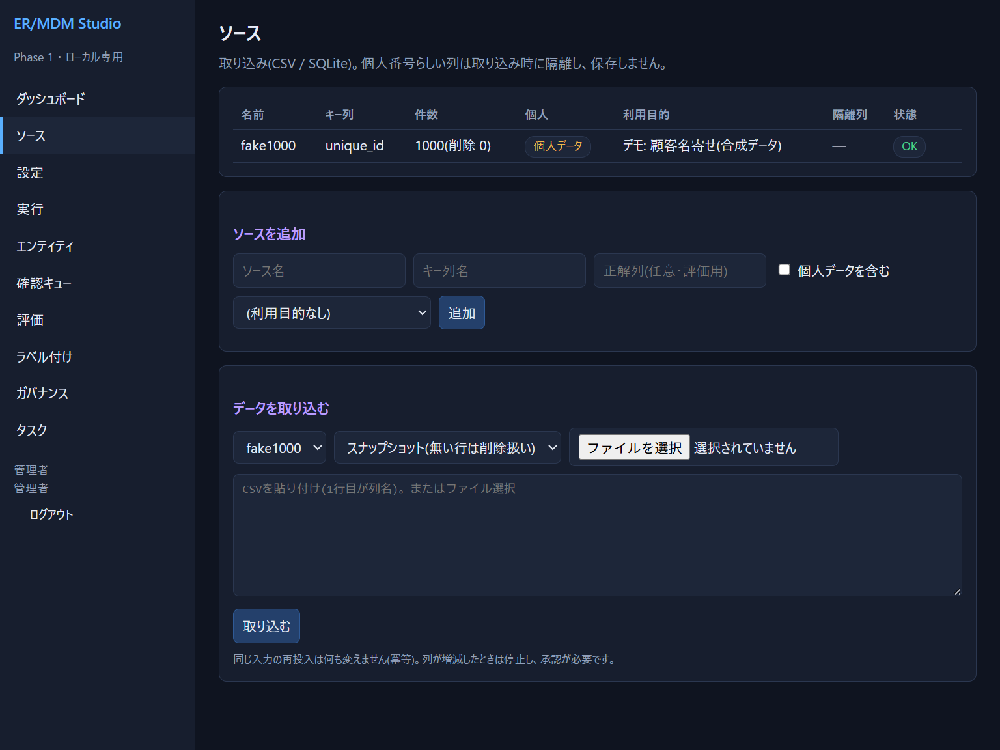

**一覧**: 名前、キー列、件数(削除済み)、個人データか、利用目的、隔離した列、状態。

- **隔離列**: 個人番号(マイナンバー)らしいと判定され、**保存しなかった列**。
- **状態**: `OK` / 「スキーマ変更の承認待ち」。後者は、列が増減したので取り込みを止めている状態です。内容を確認して「承認」を押すと、次の取り込みから通ります。

**ソースを追加**: 名前(日本語・英数字・`-_.`、60文字まで)、キー列、正解列(任意)、個人データを含むか、利用目的。

**データを取り込む**: ソースとモードを選び、CSVファイルを選ぶ(または貼り付ける)。

- スナップショット: 入力に無い既存行は**削除扱い**。
- 差分: 列 `__op` に `I`(追加)/ `U`(更新)/ `D`(削除)。
- キーが重複・空の行があると、取り込まずに止まります。
- 完了すると、画面上部に「追加 / 更新 / 削除 / 変更なし」が出ます。

## 設定

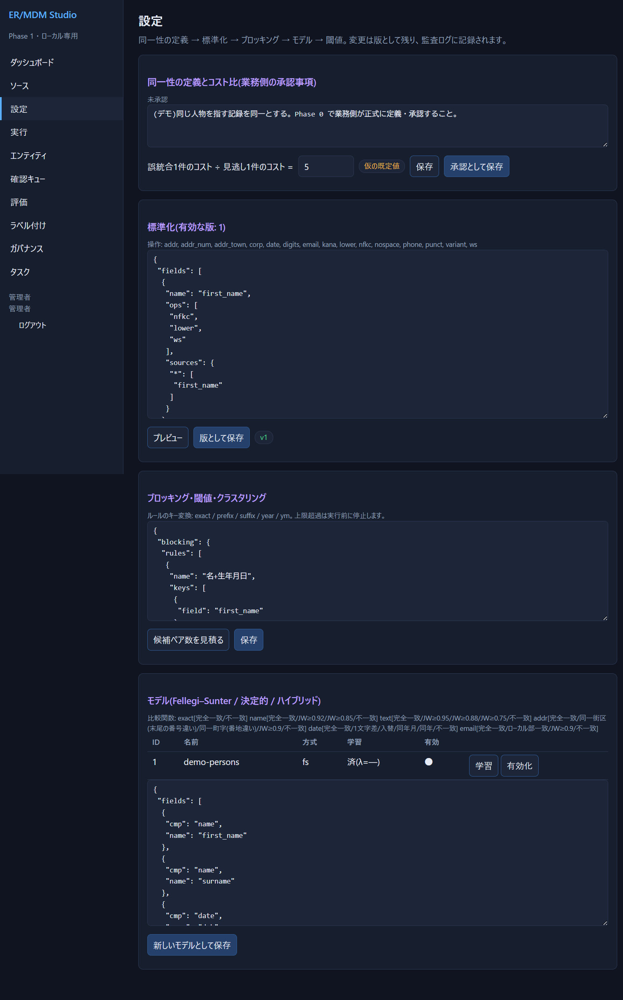

4つのカードがあります。それぞれ「保存」して初めて反映されます。**変更は版(ハッシュ)として残り、監査ログに記録されます。**

1. **同一性の定義とコスト比**: 業務側が決める。「保存」(未承認)と「承認として保存」(承認者を記録)。
2. **標準化**: JSON。「プレビュー」で先頭8件の標準化後を見る → 「版として保存」。過去の版は `v1` `v2`… として並び、「有効化」で切り替える。
3. **ブロッキング・閾値・クラスタリング**: JSON。「候補ペア数を見積る」→「保存」。
4. **モデル**: 一覧(ID・名前・方式・学習状況・有効)と、JSON入力。「学習」→「有効化」。「新しいモデルとして保存」で追加。

書き方は [06 設定リファレンス](06-config-reference.md)。

## 実行

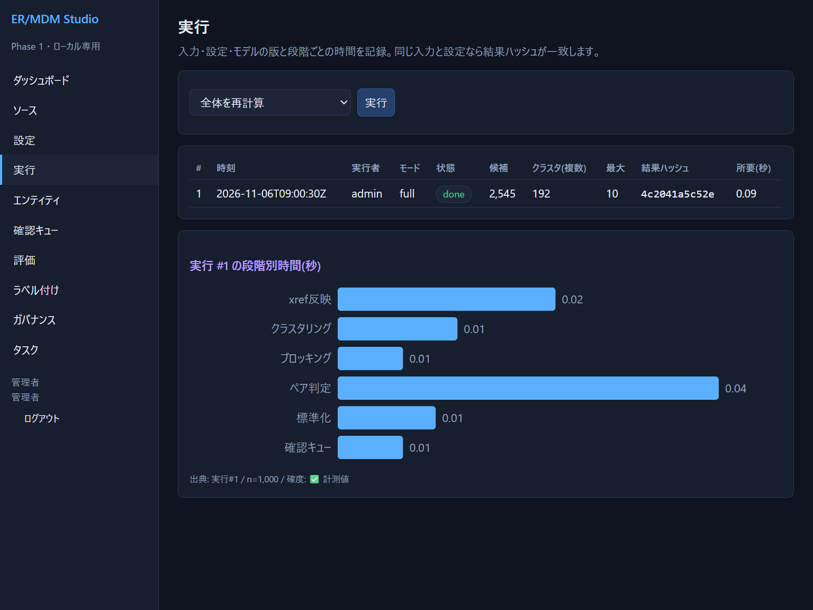

- **全体を再計算**: 標準化からやり直す。
- **再クラスタのみ(ペアは再利用)**: 閾値やクラスタリング方式だけ変えたとき。比較の計算を省くので速い。
- 一覧: 時刻、実行者、モード、状態(`done` / `failed` / `running`)、候補数、複数件クラスタ数、最大クラスタ、結果ハッシュ、所要時間。
- 下のグラフ: 段階別の所要時間。
- 実行に失敗すると、「実行」ボタンの下に理由が赤く出ます(状態は `failed`)。ガバナンス違反は**実行を始める前に**拒否され、候補ペア数の上限超過は、ペアを作る前に止まって `failed` になります。

実行の1回は、**入力データのハッシュ・設定・モデルの版**を記録します。同じ入力と設定なら結果ハッシュは同じです(✅ デモの実行で、別のデータフォルダでも同じハッシュ `4c2041a5…` になることを確認)。

## エンティティ

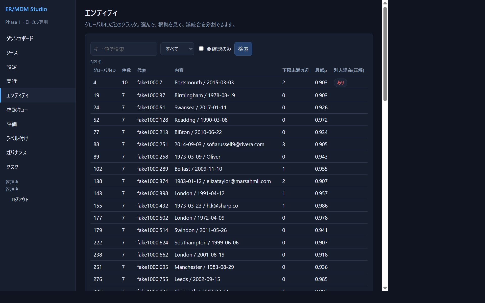

- 検索: キーや値の一部。件数での絞り込み。「要確認のみ」は、確認下限未満の辺を含むクラスタだけを出す。
- 行をクリックで詳細。

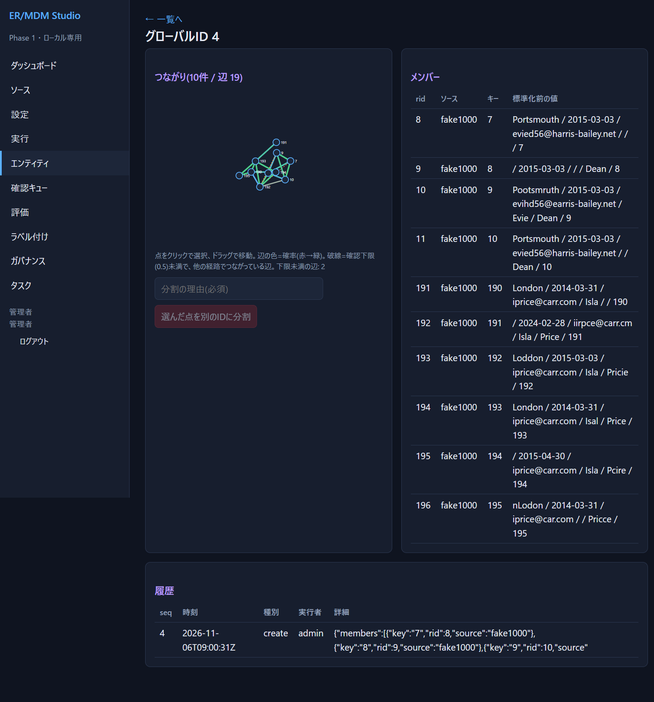

- **つながりの図**: 丸=レコード、線の色=確率(赤→緑)、破線=確認下限未満の辺。丸をクリックで選択(紫)、ドラッグで移動。ツールチップに p。
- **分割**: 点を選び、**理由を入力**して「選んだ点を別のIDに分割」。選んだ側が新しいIDになるとは**限りません**(**大きい方が元のIDを引き継ぐ**)。**全部を選ぶことはできません**(分割後に2グループ以上必要)。分割は否定制約として保存され、再実行でも覆りません。
- **メンバー**: 元の値。権限(`view_raw`)が無い役割には `●●●` で隠れます。
- **履歴**: 作成・統合・分割・更新のイベントと、制約(由来・理由・実行者)。
- 統合で廃止されたIDを開くと、「このIDは retired です。現在のID: ○○」と出て、後継IDへ辿れます。

## 確認キュー

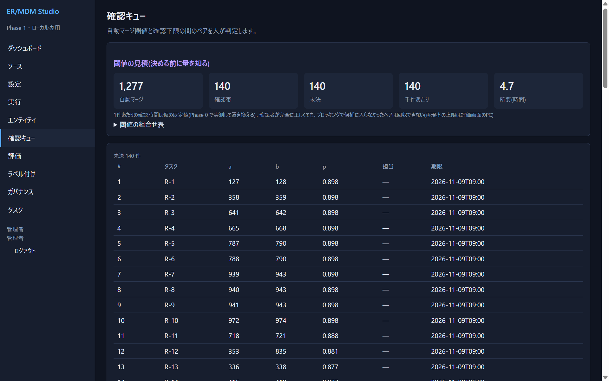

- 上: 閾値の見積(自動マージ件数、確認帯の件数、未決、1,000件あたり、所要時間)。**1件あたりの確認時間(2分)は仮の前提**です。「閾値の組合せ表」を開くと、閾値を変えたときの量が分かります。閾値自体の変更は「設定」画面のJSONで行います。
- 下: 未決の一覧(確率の高い順)。`a`・`b` はレコード番号(`rid`)。期限(SLA)は取り込みから72時間(既定)で、超過すると赤く出ます。

行を開くと、根拠が出ます。

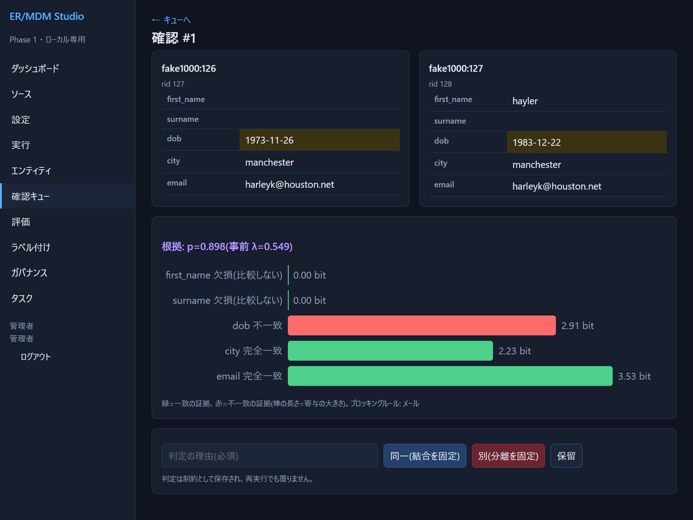

- **同一(結合を固定)**: must-link 制約。以後、必ず同じクラスタ。
- **別(分離を固定)**: cannot-link 制約。以後、必ず別クラスタ。
- **保留**: 制約は付かず、状態だけ変わります。
- **理由は必須**。判定者・日時・理由が記録され、確認項目のタスクが完了します。

## 評価

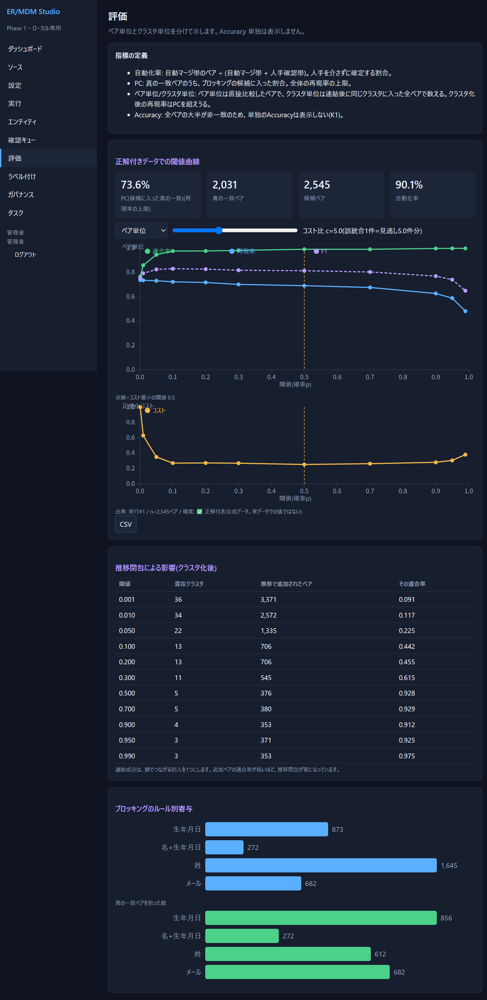

上から:

1. **指標の定義**(自動化率、PC、ペア/クラスタ、Accuracyを出さない理由)。
2. **正解付きデータでの閾値曲線**(ソースに正解列があるときだけ): PC・真の一致ペア数・候補ペア数・自動化率のカード、ペア/クラスタの切替、**コスト比スライダー**(対数。0〜2 = 1〜100)、適合率・再現率・F1の曲線、正規化コストの曲線、点線=最適閾値、「CSV」。
3. **推移閉包による影響**: 閾値ごとの、混在クラスタ数、推移で追加されたペア数、その適合率。
4. **サンプル推定**(ラベル付きサンプルがあるとき): 閾値ごとの適合率・再現率と**信頼区間**。区間が広いほど、ラベルが足りません。
5. **ブロッキングのルール別寄与**: ルールごとの候補ペア数(正解があれば、拾えた真の一致数)。**ルールの足し引きの判断**に使います。

正解もサンプルも無いときは、黄色い枠が出ます。

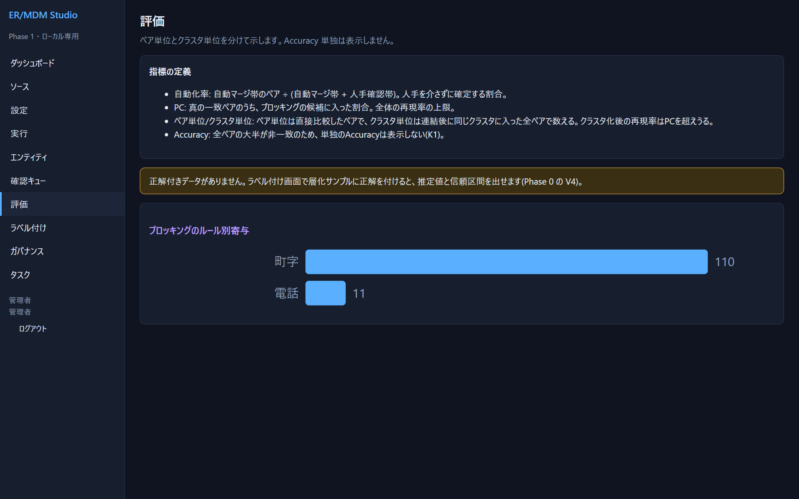

## ラベル付け

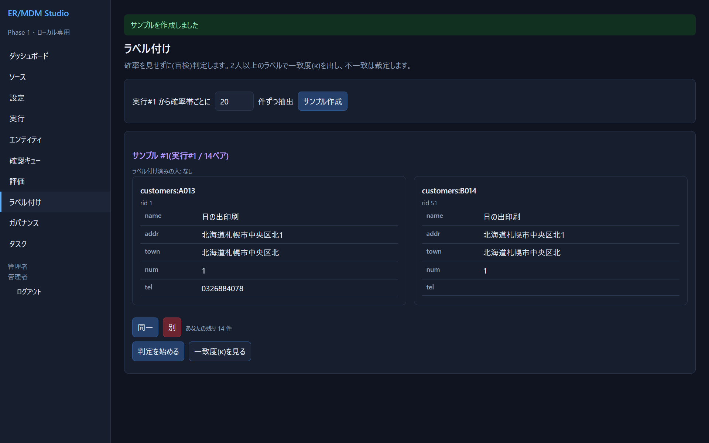

- 実行を選んで、確率帯ごとの件数を指定し「サンプル作成」。
- サンプルごとに「判定を始める」(**あなたの未判定**だけが出る)。「同一」/「別」。**確率は見えません**。
- 「一致度(κ)を見る」: 判定者の組ごとの一致率とκ(そのままのJSONで表示)。
- 食い違いの**裁定**は画面にありません(APIのみ。→ [07](07-operations.md))。

## ガバナンス

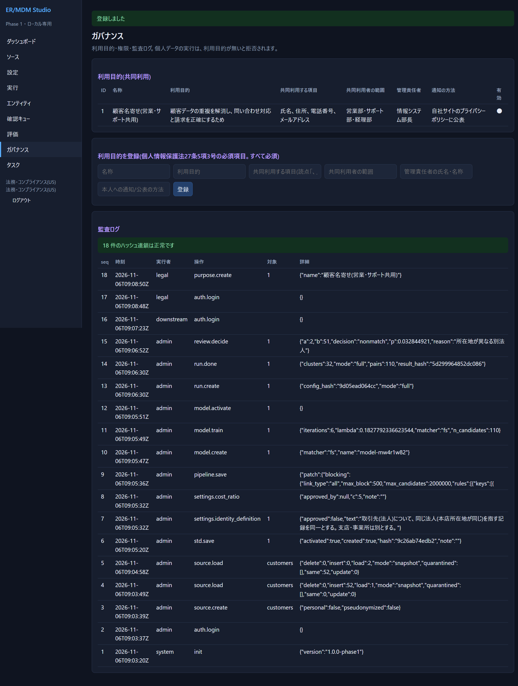

- **利用目的(共同利用)**: 個人情報保護法27条5項3号が求める項目の登録。6項目**すべて必須**(名称、利用目的、共同利用する項目、共同利用者の範囲、管理責任者、本人への通知/公表の方法)。個人データのソースは、**有効な利用目的が無いと実行できません**。
- **ユーザーと役割**(管理者のみ): 一覧。追加はコマンド(→ [07](07-operations.md))。
- **監査ログ**: 上にハッシュ連鎖の検証結果(「N件のハッシュ連鎖は正常です」)。下に最新60件。ログの更新・削除はDBが拒否します。

登録の入力例:

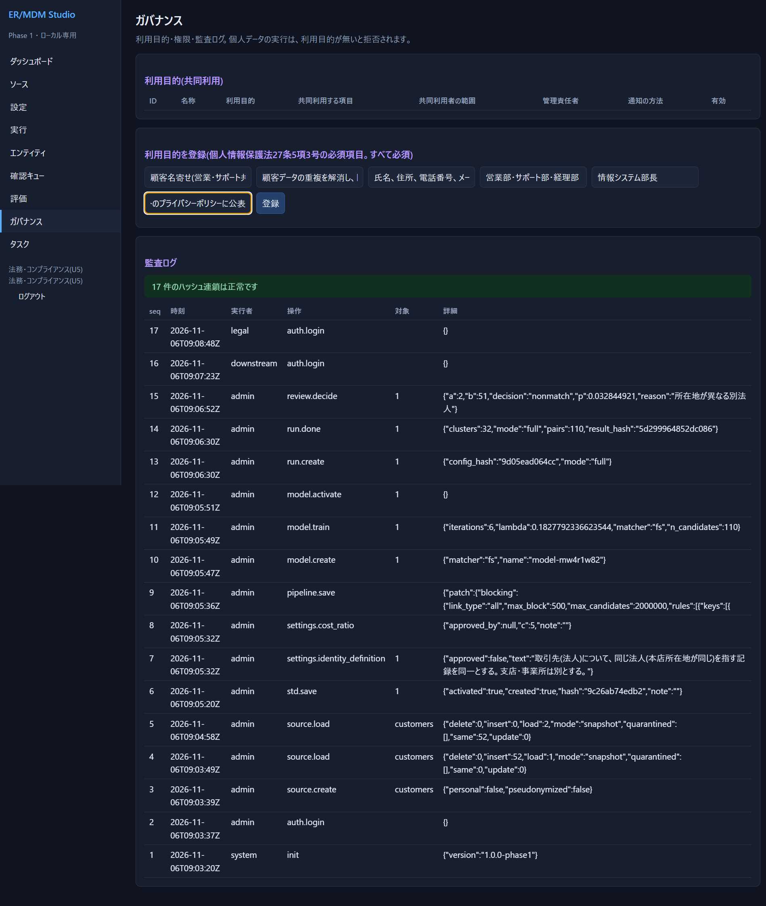

## タスク

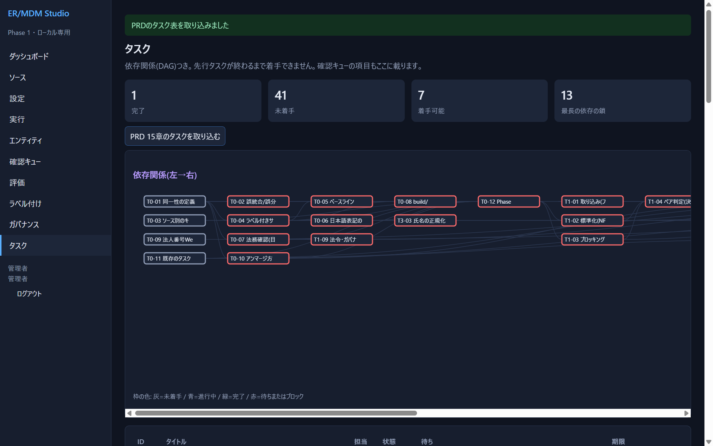

- 上のカード: 状態別の件数、着手可能な数、最長の依存の鎖。
- 「PRD 15章のタスクを取り込む」: `work/prd.md` のタスク表を取り込む(既存のIDはスキップ)。
- **依存関係の図**: 左→右。赤枠=先行タスクが未完了で着手できない。ホバーで待ち先。
- 一覧の「着手」「完了」。**先行タスクが終わっていないと着手できません**(その旨が出ます)。
- 確認キューの項目(`R-数字`)も並びます。

## 役割ごとに見える画面(例)

下流システム管理者(`downstream`)でログインすると、ラベル付けは出ず、レコードの値は `●●●` で隠れます。

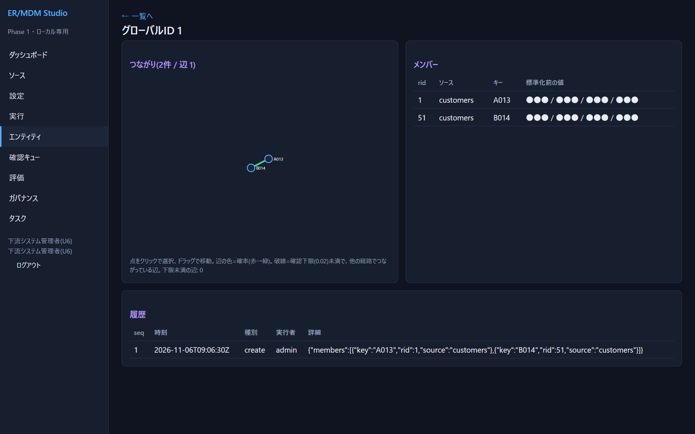

## 画面に無い操作(APIのみ)

次の操作は、画面にまだありません。APIで行います(ブラウザでログインしたまま、開発者ツールの `fetch` か、`curl` で)。

| 操作 | API |
|---|---|
| 確認項目の担当者の割り当て | `POST /api/review/{id}/assign` `{"owner":"ユーザー名"}` |
| ラベルの裁定 | `POST /api/labels/adjudicate` `{"sample_id":1,"a":rid,"b":rid,"label":1}` |
| ソースへの利用目的の紐づけ(既存ソース) | `PUT /api/sources/{id}` `{"personal":true,"purpose_id":1}` |
| タスクの新規作成・依存の編集 | `POST /api/tasks` / `PUT /api/tasks/{id}` |
| 役割の変更 | `PUT /api/users/{名前}/roles` |

`curl` の例は [07](07-operations.md) にあります。
