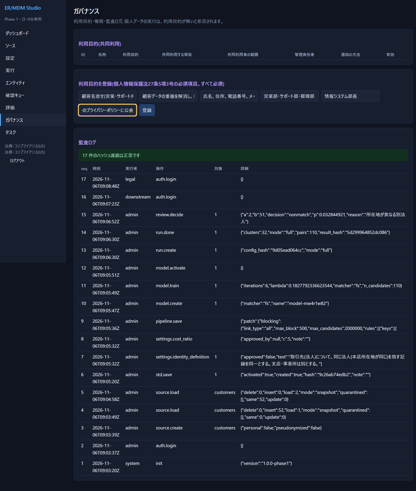
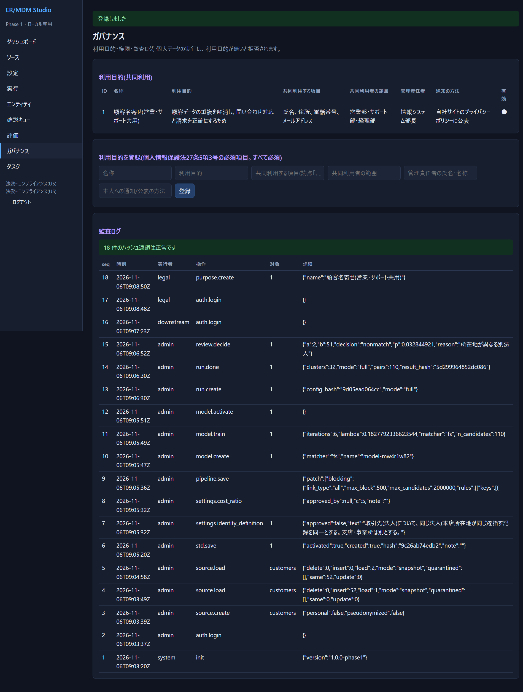

# 07 運用・ガバナンス

## 役割と権限

ユーザーは1つ以上の**役割**を持ちます。役割は、要求定義書(PRD)の利用者(U1〜U7)に対応します。

| 役割 | 名前(画面) | 主な権限 |
|---|---|---|
| `admin` | 管理者 | すべて |
| `owner` | データオーナー(U2) | 同一性の定義・コスト比、確認の判定、分割、裁定、出力、生データの閲覧 |
| `steward` | データスチュワード(U1) | 確認の判定、分割、ラベル付け、生データの閲覧 |
| `engineer` | データエンジニア(U3) | 取り込み、設定(標準化・ブロッキング・モデル)、実行、出力、生データの閲覧 |
| `evaluator` | 評価担当(U4) | ラベル付け、裁定、実行、設定、出力、生データの閲覧 |
| `legal` | 法務・コンプライアンス(U5) | 利用目的の登録、監査ログの閲覧(生データは見えない) |
| `downstream` | 下流システム管理者(U6) | 閲覧と出力のみ(生データは見えない) |
| `auditor` | 監査担当(U7) | 閲覧と監査ログのみ(生データは見えない) |

- **生データの閲覧**(`view_raw`)の無い役割には、レコードの値が `●●●` で隠れます(画面もAPIも)。
- 画面とAPIの両方で、権限が無い操作は拒否されます(403)。
- 複数の役割を持つと、権限は合算されます。

### ユーザーを追加する

管理者が、**コマンド**で追加します(サーバーを止めずに実行できます)。

```powershell
cd app
python -m ermdm useradd taro steward,evaluator --data .\data --display "田中 太郎"
# パスワードを聞かれます(8文字以上)。--password で直接指定もできます(履歴に残るので注意)
```

- 役割はカンマ区切り。使える役割: `admin, owner, steward, engineer, evaluator, legal, downstream, auditor`。
- 追加は監査ログに残ります(実行者は `cli`)。
- 役割の変更は画面にありません(API `PUT /api/users/名前/roles`。下の「APIを使う」)。
- パスワードの変更・ユーザーの無効化の機能は**ありません**(⚠ Phase 1 の限界)。

## 個人データを扱うとき(利用目的)

**個人データを含むソースは、有効な「利用目的」が登録されていないと、実行も学習もできません**(アプリが拒否します)。個人情報保護法の「共同利用」(27条5項3号)で通知・公表すべき事項を登録させる仕組みです。

> これは法的助言ではなく、**確認すべき事項を忘れないための統制**です。実際の適否は、法務・コンプライアンスに確認してください。

手順:

1. 法務(`legal`)または管理者が、「ガバナンス」→「利用目的を登録」で6項目を入力して「登録」。

   

   | 項目 | 入力例 |
   |---|---|
   | 名称 | 顧客名寄せ(営業・サポート共用) |
   | 利用目的 | 顧客データの重複を解消し、問い合わせ対応と請求を正確にするため |
   | 共同利用する項目 | 氏名、住所、電話番号、メールアドレス(読点またはカンマ区切り) |
   | 共同利用者の範囲 | 営業部・サポート部・経理部 |
   | 管理責任者 | 情報システム部長 |
   | 本人への通知/公表の方法 | 自社サイトのプライバシーポリシーに公表 |

   登録すると一覧に出ます(監査ログにも)。

   

2. 「ソース」で**新しいソースを追加**するとき、「個人データを含む」をオンにして、利用目的を選ぶ。
   - 既存のソースに後から紐づけるのは、画面にありません(API `PUT /api/sources/{id}`)。
3. 仮名加工した情報も、**個人情報として扱われます**。ソースを `pseudonymized`(APIで設定)にすると、同じ統制が掛かります。

### 個人番号(マイナンバー)

- 取り込み時に、**列名**(「マイナンバー」「個人番号」「my number」など)と、**値の12桁のチェックデジット**で検出します。検出された列は**保存しません**(隔離)。
- 隔離された列を、標準化・ブロッキング・モデルで使うことは**できません**(保存が拒否される)。キー列や正解列にもできません。
- 検出は完全ではありません(12桁でない形式、列名が違う、チェックデジットに偶然一致しない場合は見逃す)。**取り込む前に、個人番号の列を除いてください。**

## 監査ログ

ログイン、設定の変更、取り込み、実行、判定、分割、利用目的、出力などが記録されます。

- ハッシュで**連鎖**していて、1行でも書き換え・削除すると検証で見つかります。DBも更新・削除を拒否します。
- 画面: 「ガバナンス」の「監査ログ」(法務・監査担当・管理者)。
- コマンドで検証: `python -m ermdm verify --data .\data` → 「監査ログ N 件: 連鎖は正常です」。壊れていれば、壊れた番号(`seq`)を出して終了コード1。
- ダッシュボードに、連鎖が壊れていれば赤い警告が出ます。

⚠ ハッシュ連鎖は**DBの全体を作り直す改ざん**までは防げません(ファイル全体の差し替え)。重要なら、定期的にログのハッシュを別の場所へ控えてください。

## 再現性

- 同じ入力・設定・モデル・種なら、**結果ハッシュが同じ**になります。変わったら「何かが違う」ということです。
- 「実行」の履歴で、実行ごとのハッシュと所要時間を比べます。
- 入力データも、取り込みのたびにハッシュが記録されます(同じ内容なら「変更なし」)。

## バックアップと復旧

データは `--data` フォルダの **`ermdm.db`**(SQLite、WALモード)だけです。

- **止めてからコピー**: サーバーを止め、`ermdm.db`(あれば `ermdm.db-wal`、`ermdm.db-shm` も)を丸ごとコピー。
- **動かしたままコピー**:

  ```powershell
  python -c "import sqlite3; s=sqlite3.connect(r'.\data\ermdm.db'); d=sqlite3.connect(r'.\backup.db'); s.backup(d)"
  ```

  ✅ 動作確認済み。
- 復旧は、サーバーを止めて `ermdm.db` を戻して起動するだけです。
- ⚠ DBには**元の値(生データ)**が入っています。バックアップも個人データとして管理してください。

## 結果を下流システムへ渡す

| 取り出すもの | 方法(`export` 権限) |
|---|---|
| xref(CSV) | `GET /api/export/xref.csv` |
| 変更イベント(JSON Lines) | `GET /api/export/events.jsonl?since=最後に処理したseq` |
| 1件ずつ引く | `GET /api/xref?source=ソース名&key=キー` / `GET /api/gid/ID/resolve` |

**`events.jsonl` の使い方**: 下流は、最後に処理した `seq` を覚えておき、次回は `since=その値` を付けて取得します。イベントの種類:

| type | 意味 |
|---|---|
| `create` | 新しいグローバルIDができた |
| `merge` | 2つ以上のIDが統合され、若いIDが残り、他は廃止(後継=残ったID) |
| `split` | 分割で新しいIDができた(前身=元のID) |
| `update` | メンバーの追加・削除 |
| `retire` | メンバーがいなくなり(ソースでの削除など)、IDが廃止された |

取り出しは監査ログに残ります。

## APIを使う

画面に無い操作や、他システムからの連携にはAPIを使います。**ブラウザと同じ**ログイン(Cookie)が要ります。

```powershell
# ログイン(セッションを保持)
$b = @{username='admin'; password='パスワード'} | ConvertTo-Json
Invoke-RestMethod -Uri http://127.0.0.1:8800/api/login -Method Post -Body $b -ContentType 'application/json' -SessionVariable s

# 例: 確認項目 2 を taro に割り当てる
Invoke-RestMethod -Uri http://127.0.0.1:8800/api/review/2/assign -Method Post -Body (@{owner='taro'} | ConvertTo-Json) -ContentType 'application/json' -WebSession $s

# 例: 確認キューの一覧
(Invoke-RestMethod -Uri 'http://127.0.0.1:8800/api/review?status=open' -WebSession $s).items | Select-Object id,task_id,owner
```

✅ PowerShell 7 で動作確認。要点:

- 書き込みは **JSON**(`Content-Type: application/json`)のみ。
- ブラウザ以外からは、`Origin` ヘッダを付けないでください(付けると、自分のオリジン以外は拒否)。
- エラーは `{"error": "理由"}` と HTTP ステータス(400 入力不正 / 401 未ログイン / 403 権限なし / 404 無い / 409 状態が許さない)。
- 主な API(全部は `app/ermdm/server.py` の `@route`):

| 目的 | API |
|---|---|
| 状態・未決事項 | `GET /api/status` |
| ソース | `GET/POST /api/sources`、`POST /api/sources/{id}/load` |
| 設定 | `GET/PUT /api/pipeline`、`GET/POST /api/std`、`GET/POST /api/models` |
| 実行 | `POST /api/runs` `{"mode":"full"}`、`GET /api/runs/{id}` |
| ペアの根拠 | `GET /api/explain?run=1&a=rid&b=rid` |
| 分割 | `POST /api/entities/{gid}/unmerge` `{"parts":[[rid,...]],"reason":"…"}` |
| ラベル裁定 | `POST /api/labels/adjudicate` |
| 役割の変更 | `PUT /api/users/{名前}/roles` `{"roles":["steward"]}` |
| タスク | `GET/POST /api/tasks`、`PUT /api/tasks/{id}` |

## 日常の運用の流れ(例)

1. 新しいデータが届く → 「ソース」で取り込み(スナップショットか差分)。
2. 「実行」(全体を再計算)。結果ハッシュと、ダッシュボードの数値を前回と比べる。
3. 「確認キュー」の期限超過がないか。担当者が判定する。
4. 「エンティティ」で、「要確認のみ」を見て、怪しいクラスタを分割する。
5. 下流へ xref と events を渡す。
6. 月次: ラベルのサンプルで精度を再測定する(データの傾向が変わっていないか)。
7. 監査ログを `verify` する。
